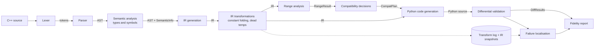
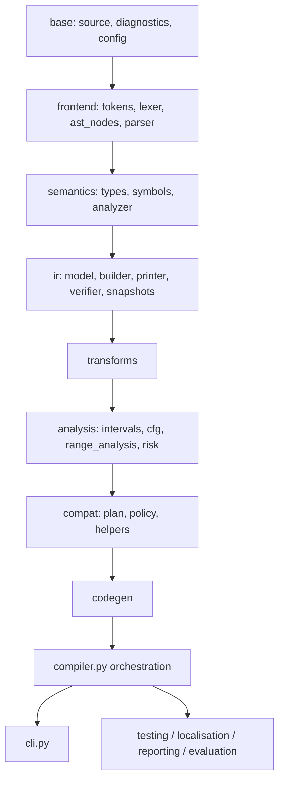
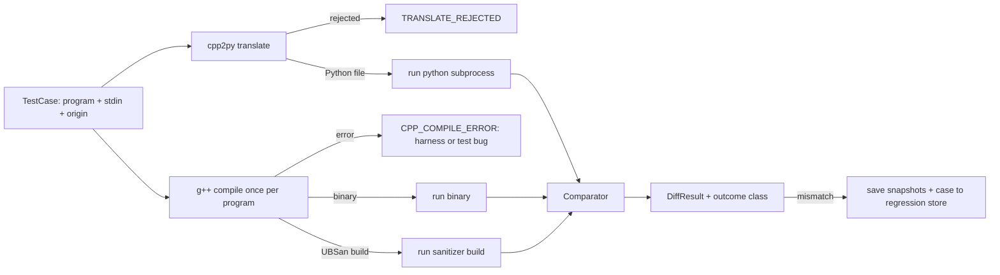

# ARCHITECTURE — C++ → Python Source-to-Source Translator (`cpp2py`)

| | |
|---|---|
| Document status | Draft v0.1 — **design only. No implementation exists and no tests have been run.** |
| Written | 2026-10-18 |
| Companion files | `IMPLEMENTATION_PLAN.md` (phases, acceptance criteria, agent prompts), `AGENTS.md` (persistent agent rules) |
| Authority | These three files must agree. If they conflict, stop, reconcile them, and record the resolution in §K.1 before writing code. |

---

## 0. Evidence status: what is verified, proposed, and assumed

This document separates three kinds of statement. Every section below is **Proposed** unless marked otherwise.

| Kind | Meaning | Content |
|---|---|---|
| **Verified fact** | Observed directly by inspecting the environment on 2026-10-18 | V1: the working directory contained no source files, no `.git` repository, no README and no earlier plan. V2: therefore no lexer, parser, IR, tests or documentation existed before these three files. V3: no test has ever been run for this project. |
| **Proposed design** | A decision made here, to be implemented and checked in later phases | Everything in §A–§J unless flagged otherwise. Decisions carry IDs `D1…Dn` in §K.1. |
| **Assumption to validate** | Something the design depends on but that nobody has confirmed | Listed as `Q1…Qn` in §K.4 (for example the exact C++ compiler, and the "agreed" I/O syntax). |

Phase tags such as **[P1]** mean "introduced in Phase 1 of `IMPLEMENTATION_PLAN.md`". Nothing tagged **[P2]** or later may be required to complete Phase 1.

**Status rule.** The implementation status of every feature is tracked in exactly one place: the status table at the top of `IMPLEMENTATION_PLAN.md`. This file never says a feature "works"; it says what the design requires.

---

## A. Project goals and scope

### A.1 Problem

Translate a **restricted subset of C++** into **readable Python** such that, for supported programs run on valid inputs, the Python program produces the same observable behaviour as the C++ program: the same standard output and the same process exit status.

Python and C++ disagree on integer semantics in ways that make naive operator-by-operator translation wrong:

| Operation | C++ (target model) | Python | Consequence of naive mapping |
|---|---|---|---|
| `a / b` on integers | truncates toward zero | `//` floors toward −∞ | `-7 / 2` is `-3` in C++ but `-4` with `//` |
| `a % b` | result takes the sign of `a` | result takes the sign of `b` | `-7 % 2` is `-1` in C++ but `1` in Python |
| Integer width | fixed (e.g. 32-bit `int`) | arbitrary precision | values past 2³¹−1 exist in Python only |
| Signed overflow | **undefined behaviour** | no overflow | no analogue; must be a stated policy |
| Division by zero | undefined behaviour (usually a crash) | `ZeroDivisionError` | both fail, differently |

### A.2 Main technical contribution

**Range analysis guides selective insertion of compatibility operations.** A baseline translator that always protects every risky operation produces correct but cluttered code (`_cpp_div(a, b)` everywhere). A baseline that never protects produces clean but sometimes wrong code. This project's translator runs an interval analysis on its IR and inserts a compatibility helper **only where the proven operand ranges allow the native Python operator to differ from C++**. Where ranges prove the native operator is equivalent (for example `i / 2` with `i ∈ [0, 100]`), plain Python is emitted. Where ranges are unknown, the analysis is conservative and the helper is inserted.

Supporting contributions (needed to make the main one measurable and defensible): a custom IR with stable operation IDs, a transformation log with snapshots, a differential-testing harness, heuristic failure localisation, and a fidelity report.

### A.3 Supported language subset (target of Phases 1–5)

| Feature | Phase | Notes |
|---|---|---|
| Program shape: `#include <iostream>`, optional `using namespace std;`, `int main() { ... }` | P1 | Only this header. Other functions arrive in P3. |
| Type `int` | P1 | Width from `TargetModel` (default 32 bits). |
| Type `long long` | P5 | Default 64 bits. Mixed `int`/`long long` arithmetic uses the usual promotions. |
| Declarations `int x;` `int x = e;` `int a, b = 2;` | P1 | |
| Assignment `x = e;` | P1 | Statement level only. |
| `+= -= *= /= %=` and `x++; x--; ++x; --x;` | P3 | Statement level only (and `for` update clause). |
| Expressions: integer literals, names, unary `+`/`-`, binary `+ - * / %`, parentheses | P1 | |
| Relational `< <= > >= == !=` | P3 | **Only as a condition** of `if`/`while`/`for`. |
| Input `cin >> a >> b;` | P1 | Whitespace-separated decimal integers. |
| Output `cout << e << "text" << endl;` | P1 | String literals allowed only as output items; `"\n"` allowed. |
| `if` / `else if` / `else` | P3 | |
| `while`, `for(init; cond; update)` | P3 | `cond` is mandatory. |
| `return` | P1 (only `return 0;` as the last statement of `main`), P3 (general) | |
| Functions with `int`/`void` return type and `int`/`long long` by-value parameters; calls; recursion | P3 | Must be defined before use (no prototypes). |

The input/output syntax above (`std::cin`, `std::cout`, `std::endl`) is **Assumption Q2**: it must be confirmed as the "agreed" syntax before Phase 1 starts.

### A.4 Explicit exclusions (reported as errors, never guessed at)

`float`/`double`, `bool`, `char`, `unsigned` and all other integer types, strings as objects, arrays, pointers, references, `struct`/`class`, templates, STL, global variables, `const`/`constexpr`/`auto`, `&&`, `||`, `!`, the ternary operator, `break`, `continue`, `do…while`, `switch`, `goto`, bitwise operators and shifts, casts, `sizeof`, expression-position assignment or `++/--`, relational/logical expressions used as integer values, function overloading and default arguments, prototypes, any preprocessor directive other than `#include <iostream>`, namespaces other than `std`, `scanf`/`printf`, handling of failed `cin` reads, multiple translation units.

`&&`/`||`/`!` are deliberately excluded because short-circuit evaluation needs region-aware condition lowering (see §K.3, risk R6). They are the first candidate extension after Phase 8.

### A.5 Project assumptions

| ID | Assumption |
|---|---|
| S1 | Reference compiler: GCC `g++`, `-std=c++17 -O0` (confirm in Q1). |
| S2 | Two's-complement integers; `int` = 32 bits, `long long` = 64 bits (configurable via `TargetModel`, §E.1). |
| S3 | Programs read only stdin and write only stdout; they are deterministic. |
| S4 | Test inputs are well-formed whitespace-separated integers inside the declared type range and containing enough values; behaviour on malformed or exhausted input is **out of contract**. |
| S5 | Generated Python targets CPython ≥ 3.10; the translator itself uses only the Python standard library (plus `pytest` as a development-only dependency). |
| S6 | "Same behaviour" means identical stdout bytes (after newline normalisation) and identical exit status, for inputs on which the C++ program has no undefined behaviour. |

---

## B. End-to-end compiler pipeline



Phases build this up incrementally: **P1** has Lexer → Parser → Semantic → (bootstrap) direct AST→Python generation. **P2** inserts the IR and moves code generation onto it. **P3** widens the language. **P4** adds transformations and the log. **P5** adds range analysis and compatibility decisions. **P6–P8** add validation, diagnosis and evaluation.

### B.1 Stage contracts

| # | Stage | Responsibility | Input → Output | Depends on | Errors it may report |
|---|---|---|---|---|---|
| 1 | Lexer **[P1]** | Characters → tokens with spans; skip whitespace/comments; accept only the one allowed `#include` | `SourceFile` → `list[Token]` | `source`, `diagnostics` | E1001–E1005 |
| 2 | Parser **[P1]** | Tokens → AST by recursive descent; recognise-and-reject known-unsupported constructs; recover at `;`/`}` to report several errors | tokens → `Program` | lexer output, AST nodes | E2001–E2003, E4001–E4003 |
| 3 | Semantic analysis **[P1]** | Scopes, declarations, type of every expression, definite assignment, call checking, "condition-only" rule | `Program` → `SemanticInfo` | AST, symbols, types | E3001–E3009, E4xxx |
| 4 | IR generation **[P2]** | Lower AST to three-address IR with stable op IDs and spans; lower `for` to loop form; rename shadowed variables | `Program` + `SemanticInfo` → `IRModule` | AST, `SemanticInfo`, IR model | E9001 on internal inconsistency |
| 5 | IR verification **[P2]** | Check IR invariants (§D.3.8). Runs after generation and after every pass in debug/test mode | `IRModule` → ok or E5001 | IR model | E5001 |
| 6 | IR transformations **[P4]** | Run passes through a pass manager; log every change; save snapshots | `IRModule` → `IRModule` + `TransformLog` | IR, pass manager | W6004; E5001 if a pass breaks invariants |
| 7 | Range analysis **[P5]** | Forward interval dataflow over a CFG built from the IR | `IRModule` + config → `RangeResult` | IR, `analysis.cfg`, `analysis.intervals` | W6005 (assumed ranges used) |
| 8 | Compatibility decisions **[P5]** | Classify semantic risk per operation; choose native vs helper per operation | `IRModule` + `RangeResult` + config → `CompatPlan` | range result, helper catalogue | W6002, W6003, W6006 |
| 9 | Python code generation **[P1 bootstrap, P2 IR-based]** | Emit readable Python; apply the plan; mangle names; self-check with `compile()` | `IRModule` + `CompatPlan` → Python text | IR, plan, helper sources | E9001 if emitted text fails `compile()` |
| 10 | Differential validation **[P6]** | Run C++ and Python on the same inputs; classify outcomes | program + inputs → `DiffResult` | compiler API, subprocess | harness-level errors only |
| 11 | Fidelity reporting **[P7]** | Aggregate plan, diagnostics, test results and suspects into a report | all artifacts → report (JSON + Markdown) | everything above | none |

### B.2 Handling unsupported constructs without misleading output

1. **Detect early.** The parser keeps a table of recognised-but-unsupported keywords/tokens (`float`, `while` before P3, `&&`, `class`, …). Meeting one produces `E4001 unsupported construct '<name>'` with a span and a one-line "not supported in this version" explanation. It never parses the construct "approximately".
2. **Never guess types or semantics.** Unknown identifiers, unknown types and unknown headers are errors (`E3001`, `E4002`, `E4003`), not warnings.
3. **No partial output.** If any diagnostic of severity ERROR exists, no Python file is written. `translate` exits with status 2.
4. **Warnings must be visible.** Where output is accepted but may differ from C++ (for example `/` in `naive` mode before P5), the translator prints a warning with a stable code (`W6001`) **and** writes a comment into the generated file header, so the divergence travels with the artifact.
5. **Self-check.** Generated text is passed through `compile()`; failure is an internal error (E9001), never silently emitted.
6. **Recovery is for reporting only.** Parser error recovery exists to show several errors per run; recovered ASTs are never passed to later stages.

### B.3 Exit statuses (CLI)

| Status | Meaning |
|---|---|
| 0 | Success (translation written; for `difftest`: no mismatches) |
| 1 | Usage or I/O error |
| 2 | Source rejected (ERROR diagnostics) |
| 3 | Internal compiler error |
| 4 | `difftest`/`eval` completed and found mismatches |

---

## C. Module and directory architecture

### C.1 Layering rule



An arrow means "may import". **A module may import only from layers to its left/above in this chain, never from layers after it.** Concretely: `frontend` never imports `ir`; `ir.model` never imports `frontend` (only `ir.builder` may import AST nodes); `analysis` never imports `codegen`; `codegen` never imports `testing`. `testing`, `localisation`, `reporting` and `evaluation` use the public `compiler` API and result dataclasses only. A test (`tests/unit/test_layering.py`, **[P2]**) enforces this with a simple import scan.

### C.2 Directory layout (final shape; files appear in the phase tagged)

```text
repo-root/
├── ARCHITECTURE.md  IMPLEMENTATION_PLAN.md  AGENTS.md  README.md   [P0]
├── pyproject.toml  .gitignore                                       [P0]
├── cpp2py/
│   ├── __init__.py                       [P0]  __version__ only
│   ├── __main__.py  cli.py               [P1]
│   ├── compiler.py                       [P1]  orchestration
│   ├── source.py  diagnostics.py  config.py          [P1]
│   ├── frontend/    tokens.py lexer.py ast_nodes.py parser.py ast_printer.py   [P1]
│   ├── semantics/   types.py symbols.py analyzer.py                   [P1]
│   ├── ir/          model.py builder.py printer.py verifier.py snapshots.py   [P2]
│   │                serialization.py                                      [P7]
│   ├── codegen/     names.py pyexpr.py ast_to_python.py   [P1; ast_to_python removed P3]
│   │                python_gen.py                          [P2]
│   ├── transforms/  manager.py log.py constant_fold.py dead_temps.py   [P4]
│   ├── analysis/    intervals.py cfg.py range_analysis.py risk.py      [P5]
│   ├── compat/      policy.py plan.py helpers.py                       [P5]
│   ├── testing/     cxx_runner.py py_runner.py comparator.py difftest.py corpus.py
│   │                regression.py testgen/programs.py testgen/inputs.py   [P6]
│   ├── localisation/ ir_interpreter.py replay.py slicing.py ranking.py     [P7]
│   ├── reporting/   fidelity.py render.py                                   [P7]
│   └── evaluation/  presets.py metrics.py experiments.py faults.py tables.py  [P8]
├── tests/
│   ├── unit/  integration/  differential/  regression/                [dirs appear with first file]
├── examples/    worked/ phase1/ phase2/ ...   each: name.cpp, name.in (optional), name.expected
├── benchmarks/  programs/*.cpp labels.json   [P8]
├── docs/        LIMITATIONS.md [P8]
└── out/         (git-ignored) generated Python, snapshots, logs, reports
```

No empty placeholder modules are created. A directory or file is created in the phase that first needs it.

### C.3 Module contracts

| Module | Responsibility | Public interface (summary) | Depends on | Must **not** |
|---|---|---|---|---|
| `source` | Source text, line/column mapping | `SourceFile`, `Pos`, `SourceSpan` | — | read files other than via a passed path; know about tokens |
| `diagnostics` | Collect and format diagnostics; code registry | `Severity`, `Diagnostic`, `DiagnosticSink`, `render(diag, source)` | `source` | raise for user errors (it records them) |
| `config` | All tunable choices | `CompilerConfig`, `TargetModel`, `CompatMode`, `OverflowPolicy` | — | hold mutable global state |
| `frontend.lexer` | Text → tokens | `tokenize(source, sink) -> list[Token]` | `source`, `diagnostics`, `tokens` | parse; evaluate; decide supportedness beyond lexical rules |
| `frontend.parser` | Tokens → AST | `parse(tokens, sink) -> Program or None` | `ast_nodes`, `tokens` | resolve names; compute types; fold constants |
| `frontend.ast_nodes` | Immutable AST dataclasses | node classes (§D.2) | `source` | contain behaviour beyond construction/traversal helpers |
| `frontend.ast_printer` | Readable AST dump | `dump(program) -> str` | `ast_nodes` | change the AST |
| `semantics.analyzer` | Scopes, types, checks | `analyze(program, config, sink) -> SemanticInfo or None` | `symbols`, `types`, AST | mutate the AST; generate IR/Python |
| `ir.model` | IR dataclasses and IDs | `IRModule`, `IRFunction`, `Instruction`, operands, `IdAllocator` | `source` (spans only) | import frontend/semantics; contain passes |
| `ir.builder` | AST → IR | `build_ir(program, info, config) -> IRModule` | AST, `SemanticInfo`, `ir.model` | optimise; decide compatibility |
| `ir.printer` | Stable text form | `format_module(m)`, `format_instruction(i)` | `ir.model` | reorder or normalise semantically |
| `ir.verifier` | Invariant checks | `verify(m) -> list[Diagnostic]` | `ir.model` | repair IR |
| `ir.snapshots` | Persist IR stages | `SnapshotStore.save(stage, module)` | printer, `ir.model` | decide *when* to snapshot (caller does) |
| `transforms.manager` | Run passes, log, verify, snapshot | `run_pipeline(module, passes, ctx)` | `ir`, `log` | contain pass logic |
| `transforms.log` | Transformation records | `TransformRecord`, `TransformLog`, JSONL I/O | `ir.model` | mutate IR |
| `transforms.constant_fold` | Fold constants (C++ semantics) | `ConstantFold` pass | `ir`, `config` | analyse ranges; touch control flow |
| `transforms.dead_temps` | Remove unused temporaries | `DeadTempElimination` pass | `ir` | remove variable writes or I/O |
| `analysis.intervals` | Interval arithmetic | `Interval` + transfer functions | — | know about IR |
| `analysis.cfg` | Basic blocks / edges from labelled IR | `build_cfg(func)` | `ir.model` | modify IR |
| `analysis.range_analysis` | Forward dataflow | `analyze_ranges(module, config) -> RangeResult` | `intervals`, `cfg`, `ir` | choose helpers; emit code |
| `analysis.risk` | Per-op risk classification | `classify(op, ranges, config) -> frozenset[Risk]` | `ranges`, `config` | choose actions |
| `compat.policy` | Risk → action rules per mode/policy | `decide(op, risks, config) -> CompatDecision` | `risk` | print or emit text |
| `compat.plan` | Collect decisions | `build_plan(module, ranges, config) -> CompatPlan` | `policy`, `analysis` | modify IR |
| `compat.helpers` | Runtime helper catalogue (real, testable functions) | `HELPERS`, `helper_source(kind) -> str` | stdlib only | import the compiler |
| `codegen.pyexpr` | Precedence-aware Python expression strings | `Prec`, `render_binary(...)` | — | know AST or IR classes |
| `codegen.names` | Python-safe identifier mangling | `NameMangler` | — | touch semantics |
| `codegen.python_gen` | IR + plan → Python | `generate(module, plan, config) -> str` | IR, plan, helpers, `pyexpr`, `names` | analyse ranges; re-decide compatibility |
| `compiler` | Orchestrate stages | `compile_source(text, filename, config) -> CompilationResult` | all compiler layers | print or exit; parse CLI |
| `cli` | Argument parsing, I/O, exit codes | `main(argv) -> int` | `compiler` | contain compiler logic |
| `testing.*` | Differential testing and generation | `run_difftest(...)`, `generate_programs(seed, n)` | `compiler`, subprocess | import compiler internals (only the public API) |
| `localisation.*` | Heuristic diagnosis | `localise(case, artifacts) -> LocalisationReport` | artifacts, `ir_interpreter` | repair code; claim certainty |
| `reporting.*` | Fidelity report | `build_report(...)`, `render_markdown/json` | result dataclasses | recompute results |
| `evaluation.*` | Baselines, metrics, experiments | presets, `run_experiment(...)` | compiler API, testing | contain translator logic or fault-injection reachable from the normal CLI path |

### C.4 What must exist from the start, and what must not be created early

* **From Phase 1:** `source`, `diagnostics`, `config`, `frontend/*`, `semantics/*`, `codegen/{names,pyexpr,ast_to_python}`, `compiler`, `cli`. `config` starts minimal (only the fields Phase 1 reads).
* **Later only:** everything else, in the phase tagged in §C.2. In particular no `ir/`, `transforms/`, `analysis/`, `compat/` directories before their phase, and no "extensible plugin" machinery.
* **Abstractions we deliberately avoid:** no visitor framework (use `match`/`isinstance` dispatch in the few places that traverse), no abstract base classes beyond a small AST/IR base dataclass, no dependency-injection or plugin registry, no parser generator, no separate "type checker" object hierarchy. Passes are plain classes with a `name` and a `run` method.

---

## D. AST and IR design

### D.1 Initial grammar (EBNF)

Tags in comments show the phase that enables a rule. A rule tagged for a later phase is **parsed as unsupported (E4001)** until that phase.

```text
program       = { include_line } [ "using" "namespace" "std" ";" ] function_def { function_def } ;
                (* P1: exactly one function_def, and it must be `int main()`; more arrive in P3 *)
include_line  = "#include" "<iostream>" ;
function_def  = ( "int" | "void" ) IDENT "(" [ param { "," param } ] ")" block ;   (* params, void: P3 *)
param         = type IDENT ;                                                       (* P3 *)
type          = "int" | "long" "long" ;                                            (* long long: P5 *)
block         = "{" { statement } "}" ;
statement     = decl_stmt | assign_stmt | incdec_stmt | input_stmt | output_stmt
              | if_stmt | while_stmt | for_stmt | return_stmt | call_stmt | block ;
decl_stmt     = type declarator { "," declarator } ";" ;
declarator    = IDENT [ "=" expr ] ;
assign_stmt   = IDENT assign_op expr ";" ;
assign_op     = "=" | "+=" | "-=" | "*=" | "/=" | "%=" ;     (* only "=" in P1; compound: P3 *)
incdec_stmt   = ( IDENT ( "++" | "--" ) | ( "++" | "--" ) IDENT ) ";" ;            (* P3 *)
input_stmt    = cin_name ">>" IDENT { ">>" IDENT } ";" ;
output_stmt   = cout_name "<<" out_item { "<<" out_item } ";" ;
out_item      = expr | STRING | endl_name ;
cin_name      = [ "std" "::" ] "cin" ;   cout_name = [ "std" "::" ] "cout" ;
endl_name     = [ "std" "::" ] "endl" ;
if_stmt       = "if" "(" condition ")" statement [ "else" statement ] ;            (* P3 *)
while_stmt    = "while" "(" condition ")" statement ;                              (* P3 *)
for_stmt      = "for" "(" [ for_init ] ";" condition ";" [ for_update ] ")" statement ;  (* P3 *)
for_init      = type declarator | IDENT assign_op expr ;
for_update    = IDENT assign_op expr | IDENT ( "++" | "--" ) | ( "++" | "--" ) IDENT ;
return_stmt   = "return" [ expr ] ";" ;       (* P1: only `return 0;` last in main; P3: general *)
call_stmt     = IDENT "(" [ expr { "," expr } ] ")" ";" ;                          (* P3 *)
condition     = expr relop expr ;             (* relational expressions exist ONLY here *)
relop         = "<" | "<=" | ">" | ">=" | "==" | "!=" ;
expr          = term { ( "+" | "-" ) term } ;
term          = unary { ( "*" | "/" | "%" ) unary } ;
unary         = ( "+" | "-" ) unary | primary ;
primary       = INT_LITERAL | IDENT | IDENT "(" [ expr { "," expr } ] ")" | "(" expr ")" ;   (* call: P3 *)
INT_LITERAL   = digit { digit } ;   (* decimal only; must fit the type `int`; no suffixes *)
STRING        = '"' { char | escape } '"' ;   escape = "\n" | "\t" | "\\" | "\"" ;
```

Notes: operators are left-associative with C++ precedence; `else` binds to the nearest `if`; an `if`/`while`/`for` body that is not a block is treated as a one-statement block; `INT_MIN` cannot be written as a literal (2147483648 does not fit `int`), so tests write `-2147483647 - 1`; identifiers `cin`, `cout`, `endl`, `std`, `main` cannot be redeclared as variables.

### D.2 AST node types

AST nodes are **immutable dataclasses**. Every node carries `span: SourceSpan` and a parser-assigned `node_id: int` (unique, monotonic). Semantic results live in side tables keyed by `node_id` (`SemanticInfo`), so the AST never changes after parsing.

| Node | Fields | Phase |
|---|---|---|
| `Program` | `functions: tuple[FunctionDef]`, `uses_std: bool` | P1 |
| `FunctionDef` | `name`, `return_type: TypeSpec`, `params: tuple[Param]`, `body: Block` | P1 (main only) |
| `Param` | `type_spec`, `name` | P3 |
| `TypeSpec` | `name: "int" or "long long" or "void"` | P1 |
| `Block` | `statements: tuple[Stmt]` | P1 |
| `DeclStmt` | `type_spec`, `declarators: tuple[Declarator]` | P1 |
| `Declarator` | `name`, `init: Expr or None` | P1 |
| `AssignStmt` | `target: NameExpr`, `op: str`, `value: Expr` | P1 (`=`), P3 (compound) |
| `IncDecStmt` | `target: NameExpr`, `op: "++" or "--"` | P3 |
| `InputStmt` | `targets: tuple[NameExpr]` | P1 |
| `OutputStmt` | `items: tuple[Expr or StringLiteral or EndlMarker]` | P1 |
| `IfStmt` | `cond: Condition`, `then_body: Stmt`, `else_body: Stmt or None` | P3 |
| `WhileStmt` | `cond: Condition`, `body: Stmt` | P3 |
| `ForStmt` | `init: DeclStmt or AssignStmt or IncDecStmt or None`, `cond: Condition`, `update: AssignStmt or IncDecStmt or None`, `body: Stmt` | P3 |
| `ReturnStmt` | `value: Expr or None` | P1 (restricted), P3 |
| `CallStmt` | `call: CallExpr` | P3 |
| `Condition` | `op: str`, `left: Expr`, `right: Expr` | P3 |
| `IntLiteral` | `value: int` | P1 |
| `StringLiteral` | `value: str` (already unescaped) | P1 |
| `EndlMarker` | — | P1 |
| `NameExpr` | `name: str` | P1 |
| `UnaryExpr` | `op: "-" or "+"`, `operand: Expr` | P1 |
| `BinaryExpr` | `op: "+" "-" "*" "/" "%"`, `left`, `right` | P1 |
| `CallExpr` | `callee: str`, `args: tuple[Expr]` | P3 |

Parenthesised expressions produce no node of their own; the inner node's span is widened to include the parentheses so error messages point at the whole parenthesised text.

### D.3 Intermediate representation

#### D.3.1 Design principles

1. **IR has C++ semantics.** `div` means "C++ truncating division", `add` on `i32` means "C++ signed 32-bit addition". How to *realise* that in Python (native `//` or a helper) is decided later by the `CompatPlan`. This keeps the IR stable across baseline/enhanced translators and lets a reference IR interpreter (P7) act as an executable specification.
2. **Flat, linear, three-address code per function**, with labels, jumps and branches. Source variables are named mutable slots; temporaries are single-assignment.
3. **Structured-form invariant.** The source language has only structured control flow, so the IR generator emits control flow only in a few **canonical shapes** (§D.3.6), and labels carry a `role` and `region_id` so the Python generator can rebuild `if`/`while`/`for` without a general goto-elimination algorithm. Transformation passes in this project must preserve the shapes (the verifier checks this).
4. **Extensible without rewrite:** the complete opcode enum and the verifier cover control flow and calls from **Phase 2**, even though the builder only emits straight-line code until Phase 3. New opcodes are added to the enum; nothing else changes shape.
5. **Every instruction has a stable ID and a source span** (§F.4).

#### D.3.2 Types

| IR type | Meaning | Source |
|---|---|---|
| `i32`, `i64` | signed integers of the `TargetModel` widths for `int`, `long long` | declared types |
| `bool` | result of `cmp`; usable only as the condition of `branch` | comparisons |
| `void` | functions without a result | `void` functions |
| `str` | string constants, usable only inside `print` | string literals |

#### D.3.3 Operands

| Operand | Fields | Printed as |
|---|---|---|
| `Const` | `value: int`, `type` | `42` |
| `VarRef` | `symbol_id`, `ir_name` (unique within the live scopes of the function), `type` | `a`, `i_1` |
| `TempRef` | `temp_id`, `type` | `t0` |
| `StrConst` | `text: str` | `"x = "` |

`VarRef`s name source variables and parameters. `TempRef`s are produced by the builder, defined exactly once, and (in the canonical output of the builder) used exactly once.

#### D.3.4 Instruction set

Each instruction has `op_id`, `opcode`, optional `dst`, operands, `span`, and `origin` (§F.4).

| Opcode | Form | Meaning | Emitted from |
|---|---|---|---|
| `declare` | `declare v : type` | Introduce a variable (no value) | P2 |
| `assign` | `dst = assign src` | Copy a constant/variable/temp into a variable or temp | P2 |
| `binop` | `dst = add\|sub\|mul\|div\|mod a, b` | C++ arithmetic on equal-typed operands | P2 |
| `unop` | `dst = neg a` | C++ negation | P2 |
| `read` | `read v` | `cin >> v` for one variable | P2 |
| `print` | `print item, item, ... [, endl]` | One `cout << ...` statement | P2 |
| `label` | `L:` with `role`, `region_id` | Jump target | model P2, emitted P3 |
| `jump` | `jump L` | Unconditional transfer | model P2, emitted P3 |
| `branch` | `branch c, Ltrue, Lfalse` | Conditional transfer on a `bool` operand | model P2, emitted P3 |
| `cmp` | `dst = cmp lt\|le\|gt\|ge\|eq\|ne a, b` | Relational test producing `bool` | model P2, emitted P3 |
| `call` | `[dst =] call f(args...)` | Call a user function | model P2, emitted P3 |
| `return` | `return [operand]` | Leave the function | P2 (main), P3 |
| `cast` | `dst = cast src to type` | Integer conversion (widening exact, narrowing per `TargetModel`) | **P5** |

Functions: `IRFunction(name, params, return_type, body: list[Instruction], regions: dict[int, RegionInfo])`; `IRModule(functions, source_name)`. `RegionInfo(region_id, kind: if|while|for, span, loop_var: symbol_id or None)` lets the generator recognise `for` loops (§P4 idiomatic loops).

#### D.3.5 Labels, regions and IDs

* **Operation IDs:** `op_<n>`, allocated from one module-wide `IdAllocator`, monotonic, **never reused**. Temps `t<n>` and regions `r<n>` use their own counters.
* **Label names:** `<role>_<region>` e.g. `loop_head_r0`. Roles: `if_then`, `if_else`, `if_end`, `loop_head`, `loop_body`, `loop_end`.
* **Spans:** each instruction stores the `SourceSpan` of the AST node it came from (the whole statement for `declare/assign/print/read`, the operator expression for `binop/unop/cmp`).

#### D.3.6 Canonical control-flow shapes (emitted from P3)

```text
if / else                           while                          for  (init; cond; update)
  <cond temps>                     loop_head_rN:                    <init>
  branch c, if_then_rN, if_else_rN   <cond temps>                  loop_head_rN:
if_then_rN:                          branch c, loop_body_rN,          <cond temps>
  <then...>                                 loop_end_rN                 branch c, loop_body_rN, loop_end_rN
  jump if_end_rN                   loop_body_rN:                   loop_body_rN:
if_else_rN:                          <body...>                       <body...>
  <else...>   (may be empty)         jump loop_head_rN               <update>
if_end_rN:                         loop_end_rN:                      jump loop_head_rN
                                                                  loop_end_rN:
```

`return` may appear inside any shape. No other branch/jump patterns are legal.

#### D.3.7 Textual form (used by `--dump-ir`, snapshots and golden tests)

One instruction per line: `  <op_id>  <instruction text>   ; L<line>:<col>` with fixed column alignment, functions as `function <name>(<params>) -> <type> {` … `}`. The printer is deterministic: identical IR prints identically, so snapshots can be diffed and golden-tested. Machine-readable snapshots use JSON with the same fields.

#### D.3.8 Verifier invariants

(1) op IDs unique; (2) every `TempRef` is defined once and defined before use in program order; (3) every `VarRef` is declared (or is a parameter) before use; (4) operand and result types agree (no `bool` outside `branch`; `binop` operands same type); (5) every `jump`/`branch` target label exists exactly once in the same function; (6) labels follow the canonical shapes of §D.3.6; (7) `return` operand type matches the function type; non-`void` functions end every path in `return` except `main`, which implicitly returns 0; (8) no `div`/`mod` with a literal zero divisor is *rejected* here — that is a semantic warning, not an IR error (it is preserved faithfully).

### D.4 Worked example

**Stage 1 — C++ source** (`examples/worked/fold_demo.cpp`; expected stdout `48`; AST/IR numbering below is the *design intent*, to be confirmed when implemented)

```cpp
#include <iostream>
using namespace std;

int main() {
    int a = 6 * 7;
    int b = a + 2 * 3;
    cout << b << endl;
    return 0;
}
```

**Stage 2 — AST** (output of `--dump-ast`; node IDs omitted)

```text
Program uses_std=true
└─ FunctionDef main -> int
   └─ Block
      ├─ DeclStmt int
      │  └─ Declarator a
      │     └─ BinaryExpr *  [6, 7]
      ├─ DeclStmt int
      │  └─ Declarator b
      │     └─ BinaryExpr +
      │        ├─ NameExpr a
      │        └─ BinaryExpr *  [2, 3]
      ├─ OutputStmt
      │  ├─ NameExpr b
      │  └─ EndlMarker
      └─ ReturnStmt  IntLiteral 0
```

**Stage 3 — IR as generated** (Phase 2)

```text
function main() -> i32 {
  op_0   declare a : i32                 ; L5:5
  op_1   t0 = mul 6, 7                   ; L5:13
  op_2   a = assign t0                   ; L5:5
  op_3   declare b : i32                 ; L6:5
  op_4   t1 = mul 2, 3                   ; L6:17
  op_5   t2 = add a, t1                  ; L6:13
  op_6   b = assign t2                   ; L6:5
  op_7   print b, endl                   ; L7:5
  op_8   return 0                        ; L8:5
}
```

**Stage 4 — IR after constant folding and dead-temp elimination** (Phase 4). Passes run in this order: `ConstantFold` (REPLACE `op_1` → `t0 = assign 42`; substitute the constant temp into `op_2`; REPLACE `op_4` → `t1 = assign 6`; substitute into `op_5`), then `DeadTempElimination` (DELETE `op_1`, `op_4`). The variable `a` is *not* constant-propagated: Phase 4 has no dataflow-based propagation (that is deliberate scope control).

```text
function main() -> i32 {
  op_0   declare a : i32                 ; L5:5
  op_2   a = assign 42                   ; L5:5     [derived from op_1]
  op_3   declare b : i32                 ; L6:5
  op_5   t2 = add a, 6                   ; L6:13    [derived from op_4]
  op_6   b = assign t2                   ; L6:5
  op_7   print b, endl                   ; L7:5
  op_8   return 0                        ; L8:5
}
```

Transformation log excerpt (JSON Lines, abbreviated):

```text
{"seq":1,"pass":"constant_fold","op_id":"op_1","kind":"REPLACE","before":"t0 = mul 6, 7","after":"t0 = assign 42","line":5,"reason":"both operands constant; 6*7=42 within i32","derived_from":[]}
{"seq":2,"pass":"constant_fold","op_id":"op_2","kind":"REPLACE","before":"a = assign t0","after":"a = assign 42","line":5,"reason":"substitute constant temp t0","derived_from":["op_1"]}
...
{"seq":5,"pass":"dead_temps","op_id":"op_1","kind":"DELETE","before":"t0 = assign 42","after":null,"line":5,"reason":"t0 has no remaining uses","derived_from":[]}
```

**Stage 5 — generated Python** (Phase 4 with folding on; at Phase 2 the folding stage is absent and the output is `a = 6 * 7` / `b = a + 2 * 3`)

```python
import sys


def main():
    a = 42
    b = a + 6
    print(b)
    return 0


if __name__ == "__main__":
    sys.exit(main())
```

The Python generator inlines a temporary into its single use when every instruction between definition and use is another pure temp definition. That is why `t2` disappears into `b = a + 6`.

#### Second illustration: IR shape of a `while` loop (Phase 3 target)

```text
C++:  int i = 0;  while (i < 3) { cout << i << endl;  i += 1; }

  op_10  declare i : i32
  op_11  i = assign 0
  op_12  loop_head_r0:                    ; role=loop_head region=r0
  op_13  t0 = cmp lt i, 3
  op_14  branch t0, loop_body_r0, loop_end_r0
  op_15  loop_body_r0:
  op_16  print i, endl
  op_17  t1 = add i, 1
  op_18  i = assign t1
  op_19  jump loop_head_r0
  op_20  loop_end_r0:
```

Generated Python: `while i < 3:` / `print(i)` / `i += 1`. If the condition's temps could not all be inlined, the generator falls back to `while True:` + computed condition + `if not cond: break`.

---

## E. Semantic compatibility model

### E.1 Target model (configurable, documented)

`TargetModel` is part of `CompilerConfig` and is recorded in every snapshot manifest and fidelity report.

| Field | Default | Notes |
|---|---|---|
| `int_bits` | 32 | width of `int` |
| `long_long_bits` | 64 | width of `long long` **[P5]** |
| `representation` | two's complement | assumed; C++20 mandates it |
| `overflow_policy` | `assume_no_overflow` | see §E.3 |
| `narrowing` | `modular` | `long long` → `int` conversion keeps the value mod 2ⁿ (C++20 rule; matches GCC) |
| `reference_compiler` | `g++ -std=c++17 -O0` | used by differential testing; overflow flags follow the policy (§H.2) |

Type ranges derive from the widths: `int` ∈ [−2³¹, 2³¹−1] by default. Nothing else in the code base may hard-code 32 or 64.

### E.2 Issues and how each is handled

| Issue | C++ | Naive Python | Handling in this design | Phase |
|---|---|---|---|---|
| Division toward zero | `-7/2 == -3` | `-7//2 == -4` | `_cpp_div` helper when ranges allow a negative operand; native `//` when both operands are provably non-negative and the divisor positive | P5 |
| Remainder sign | `-7%2 == -1` | `-7%2 == 1` | `_cpp_mod` helper under the same condition as division | P5 |
| Division by zero | undefined (usually SIGFPE) | `ZeroDivisionError` | Not emulated. Flagged `W6003` when the divisor range contains 0; both programs fail and the harness classifies the case as UB-excluded | P5/P6 |
| `INT_MIN / -1`, `INT_MIN % -1` | undefined | mathematical result 2³¹ | Flagged when the ranges allow it; handled per overflow policy | P5 |
| Fixed width vs bignum | values stay in range or UB | unbounded | Types tracked per variable/operation; ranges checked against type bounds | P5 |
| Signed overflow (`+ - *`, negation) | **undefined** | silently grows | Policy-driven (§E.3). Never assumed to wrap by default | P5 |
| Narrowing `long long`→`int` | modular (C++20) | no change | `cast` op; wrap helper when range may exceed `int` | P5 |
| Constant evaluation | C++ rules | Python rules | Folding code uses C++ truncation and refuses to fold overflow or divide-by-zero | P4 |
| Evaluation order of operands | unspecified for most operators | left-to-right | Supported programs have side-effect-free operands (no expression-position assignment or `++`); calls in operands are the only exception and are documented as a limitation | P3 |
| `cin` failure, bad input | sets failbit, value changes | `ValueError`/`StopIteration` | Out of contract (assumption S4) | — |
| Deep recursion | stack-limited (large) | `RecursionError` ≈ 1000 frames | Documented limitation; tests keep depth < 500 | P3 |
| Comparison result as value | prints `1`/`0` | prints `True`/`False` | Prevented: relational expressions only appear as conditions | P3 |

### E.3 Signed overflow: three explicit policies

C++ signed overflow is **undefined behaviour**; it is *not* wraparound. The translator therefore never assumes wrapping by default.

| Policy (`OverflowPolicy`) | Meaning | Translation | C++ reference build | Soundness statement |
|---|---|---|---|---|
| `assume_no_overflow` **(default)** | The program is assumed UB-free. | No helper. Each operation that *may* overflow is reported (`W6002`); the analysis clamps its result range to the type range (valid under the assumption). | default flags | Equivalent to C++ on inputs where no UB occurs. On UB inputs nothing is promised. |
| `wrap` | Opt-in *implementation-defined target*: treat overflow as two's-complement wrap, like `g++ -fwrapv`. | `_wrap_i32`/`_wrap_i64` around exactly those operations whose result range may exceed the type range. | `-fwrapv` | Equivalent to the `-fwrapv` build. This is a chosen target, not C++ standard semantics, and the report says so. |
| `trap` | Opt-in: overflow is an error. | `_check_i32`/`_check_i64` raising `OverflowError` | `-ftrapv` | Both programs abort; classified as agreeing failure. |

### E.4 Range analysis

**Domain.** `Interval(lo, hi)` over mathematical integers, where `None` means unbounded on that side, plus `BOTTOM` (unreachable). The analysis state maps each variable and temp to an interval.

**Initial values.** Constants → singleton; `read v` → the full type range *unless* the user supplies `--assume-range main.n=1:100000`, in which case that interval is used and recorded as an **assumption** in the plan and the fidelity report (the test generator must then respect it). Parameters and call results → full type range (intra-procedural analysis only).

**Transfer functions** (computed exactly on mathematical integers, then compared to the type range):

| Op | Rule |
|---|---|
| `add`, `sub` | `[a.lo+b.lo, a.hi+b.hi]`, `[a.lo−b.hi, a.hi−b.lo]` |
| `mul` | min/max of the four corner products |
| `neg` | `[−a.hi, −a.lo]` |
| `div` (truncating) | split the divisor at 0 into `[b.lo,−1]` and `[1,b.hi]` (drop 0, it is UB); min/max of truncating quotients of the corners; empty split ⇒ result unconstrained and `W6003` |
| `mod` | if `a.lo ≥ 0`: `[0, min(a.hi, max\|b\|−1)]`; if `a.hi ≤ 0`: `[−min(\|a.lo\|, max\|b\|−1), 0]`; otherwise `[−(max\|b\|−1), max\|b\|−1]` |
| `cast` to narrower | if source range fits target → same; else target type range |
| `assign` | copy |

After computing the exact result `R` of an arithmetic op: if `R ⊆ type range`, the result is `R`. Otherwise the op is flagged `SIGNED_OVERFLOW_POSSIBLE` and the stored result range is `R ∩ type range` under `assume_no_overflow`, the full type range under `wrap`/`trap`.

**Join and loops.** Join at labels is the interval hull. At `loop_head` labels the analysis applies **widening to the type bounds** (a bound that grows jumps straight to the type min/max), so the lattice has finite effective height and the worklist algorithm terminates. No narrowing pass (documented precision loss).

**Branch refinement.** On the true/false edges of `branch c` where `c = cmp op x, y`, the interval of `x` (if a variable) is intersected with the constraint implied by the interval of `y` (and vice versa). Only simple comparisons are refined; anything else is joined unrefined.

**Conservative unknowns.** Missing information always widens toward the type range, never narrows. A variable assigned from a call, a parameter, an unrefined `read` — all `TOP = type range`.

### E.5 Risk classification and decision rules

`Risk` values: `DIV_TRUNC_DIFFERS`, `MOD_SIGN_DIFFERS`, `DIV_BY_ZERO_POSSIBLE`, `DIV_BY_ZERO_CERTAIN`, `INT_MIN_DIV_MINUS_ONE`, `SIGNED_OVERFLOW_POSSIBLE`, `NARROWING_LOSSY`.

Division and remainder (`a` = dividend range, `b` = divisor range):

| Condition | Risks | Action in `range_guided` mode |
|---|---|---|
| `a.lo ≥ 0` and `b.lo ≥ 1` | none | **NATIVE** `//` or `%` |
| `a` may be negative or `b` may be negative (and `0 ∉ {b}` or `b` has other values) | `DIV_TRUNC_DIFFERS` / `MOD_SIGN_DIFFERS` | **HELPER** `_cpp_div` / `_cpp_mod` |
| `0 ∈ b` | `DIV_BY_ZERO_POSSIBLE` (or `CERTAIN` if `b == [0,0]`) | warn `W6003`; native or helper as decided above (Python raises either way) |
| `a.lo ≤ INT_MIN` and `-1 ∈ b` | `INT_MIN_DIV_MINUS_ONE` | warn; under `wrap` compose with `_wrap_iN` |

Addition/subtraction/multiplication/negation: no risk if the exact result range fits the type; otherwise `SIGNED_OVERFLOW_POSSIBLE`, resolved by the overflow policy (§E.3).

Modes (`CompatMode`): `naive` — every op NATIVE (no analysis; `W6001` on every `/`, `%`); `always` — HELPER on every `/`, `%` and, under `wrap`/`trap`, around every `+ - *`/neg; `range_guided` — the table above. All three share every other stage (§J.1).

### E.6 Selective helper insertion

Decisions are made once per operation, keyed by `op_id`, and stored in a `CompatPlan`. The Python generator **reads** the plan; it never re-decides. A decision carries its reason, the operand and result ranges it was based on, and the active policy, so the fidelity report and the localiser can explain it.

Helper catalogue (`compat/helpers.py`; real Python functions so they can be unit-tested exhaustively on small ranges):

| Helper | Specification |
|---|---|
| `_cpp_div(a, b)` | `sign(a)·sign(b)·(\|a\| // \|b\|)`; raises `ZeroDivisionError` when `b == 0` |
| `_cpp_mod(a, b)` | `a − b·_cpp_div(a, b)` (sign follows `a`) |
| `_wrap_i32(x)`, `_wrap_i64(x)` | `x` reduced modulo 2ⁿ into [−2ⁿ⁻¹, 2ⁿ⁻¹−1] |
| `_check_i32(x)`, `_check_i64(x)` | returns `x` or raises `OverflowError` if outside the range |

Generated files are self-contained: only the helpers actually used are copied into the output, under a `# --- compatibility helpers ---` header, using the real function source.

### E.7 Explicitly supported integer-boundary cases (each gets a deterministic test in P6)

`INT_MIN` written as `-2147483647 - 1`; `INT_MAX + 1` and `INT_MIN - 1` under each policy; `INT_MIN / -1` and `INT_MIN % -1` under each policy; `-7/2`, `7/-2`, `-7/-2`, `-7%2`, `7%-2`, `-7%-2`; `0 / x` and `0 % x`; `x / 1`, `x / -1`; products near ±2³¹ and ±2⁶³; `long long` → `int` narrowing near the boundary [P5].

### E.8 Not claimed

Equivalence for the entire C++ language; behaviour of programs with undefined behaviour except under the stated policies; behaviour on malformed input; formal proof of the analysis (soundness is argued in §E.4 and *tested* — brute-force comparison on small ranges in P5, differential testing in P6 — not proven).

---

## F. Data contracts and interfaces

Sketches only — field lists and signatures, **not implementations**. Exact names may be adjusted in a phase if the deviation is recorded (AGENTS.md rule 10).

### F.1 Source locations and diagnostics

```text
Pos(line:int, col:int, offset:int)                       # 1-based line and column
SourceSpan(file:str, start:Pos, end:Pos)                  # half-open [start, end)
SourceFile(name:str, text:str)  .span(start_off, end_off) -> SourceSpan

Severity = ERROR | WARNING | NOTE
Diagnostic(severity, code:str, message:str, span:SourceSpan | None, notes:tuple[str,...] = ())
DiagnosticSink: .error(code, msg, span) .warning(...) .note(...)  .has_errors() -> bool  .all() -> tuple[Diagnostic,...]
render(diag, source) -> str        # "file:line:col: error E3001: ..." + source line + caret
```

Diagnostic code registry (stable; tests assert codes, not message text): **E1xxx** lexical, **E2xxx** syntax, **E3xxx** semantic, **E4xxx** unsupported construct/type/header, **E5xxx** IR verification, **E9xxx** internal error, **W6xxx** warnings.

| Code | Meaning |
|---|---|
| E1001 / E1002 / E1003 | invalid character / unterminated string / unterminated block comment |
| E1004 / E1005 | integer literal out of `int` range / unsupported preprocessor directive |
| E2001 / E2002 / E2003 | unexpected token (expected …) / missing `;` / unbalanced braces or parentheses |
| E3001 / E3002 / E3003 | undeclared identifier / redeclaration in same scope / use of possibly-uninitialised variable |
| E3004 / E3005 / E3006 | invalid operand or type mismatch / invalid assignment target / wrong argument count |
| E3007 / E3008 / E3009 | missing return on some path / relational expression used as a value / invalid `cin`/`cout` usage |
| E4001 / E4002 / E4003 | unsupported construct / unsupported type / unsupported header |
| E5001 | IR verification failure (internal) |
| E9001 | internal compiler error, including generated Python failing `compile()` |
| W6001 | `/` or `%` emitted with Python semantics (naive mode) |
| W6002 | operation may overflow (reported under `assume_no_overflow`) |
| W6003 | divisor may be zero |
| W6004 | constant folding skipped (would overflow or divide by zero) |
| W6005 | an assumed input range influenced a decision |
| W6006 | possibly lossy narrowing conversion |

### F.2 Configuration and compilation context

```text
TargetModel(int_bits=32, long_long_bits=64, overflow_policy=ASSUME_NO_OVERFLOW, narrowing=MODULAR)
CompilerConfig(
    target: TargetModel,
    compat_mode: CompatMode = NAIVE,           # NAIVE until P5 is complete; RANGE_GUIDED becomes the default only in P5
    fold_constants: bool = True,                # P4
    idiomatic_loops: bool = False,              # P4
    assumed_ranges: dict[str, Interval] = {},   # P5, key "function.variable"
    snapshot_dir: Path | None = None,           # P2
    transform_log_path: Path | None = None,     # P4
    verify_ir_between_passes: bool = True,      # P2/P4
)
CompilationContext(config, source: SourceFile, sink: DiagnosticSink, ids: IdAllocator, snapshots: SnapshotStore | None, log: TransformLog | None)
```

### F.3 Stage interfaces

```text
tokenize(source: SourceFile, sink) -> list[Token]
parse(tokens, sink) -> Program | None
analyze(program, config, sink) -> SemanticInfo | None
build_ir(program, info, ctx) -> IRModule
run_pipeline(module, passes: list[IRPass], ctx) -> IRModule                  # P4
analyze_ranges(module, ctx) -> RangeResult                                    # P5
build_plan(module, ranges, ctx) -> CompatPlan                                 # P5
generate(module, plan, ctx) -> str                                            # P2 (P1: from AST)
compile_source(text, filename, config) -> CompilationResult

Token(kind, text, span)
SemanticInfo(symbols_by_node: dict[int, Symbol], type_by_node: dict[int, IntType], functions: dict[str, FunctionSymbol])
Symbol(symbol_id, name, type, kind, decl_span)
CompilationResult(success: bool, python_source: str | None, diagnostics: tuple[Diagnostic,...],
                  ast: Program | None, ir: IRModule | None, transform_log: TransformLog | None,
                  ranges: RangeResult | None, plan: CompatPlan | None, artifact_dir: Path | None)
```

`IRPass` protocol: `name: str` and `run(func: IRFunction, rw: IRRewriter, ctx) -> None`. **A pass may change IR only through `IRRewriter`** (`replace`, `delete`, `insert_before/after`, `substitute_operand`). The rewriter allocates IDs, updates spans, and writes the `TransformRecord`s; a pass therefore cannot change IR without logging it.

### F.4 Source locations and operation IDs across transformations

| Event | op_id | span | `origin` / log |
|---|---|---|---|
| **REPLACE** (instruction rewritten in place, e.g. fold `mul 6,7` → `assign 42`) | unchanged | unchanged | record with before/after text, reason |
| **Operand substitution** (const temp pushed into a user) | unchanged | unchanged | REPLACE record; `derived_from` = op IDs of the definitions consumed |
| **SPLIT** (one op becomes several) | first new op keeps the old ID; others get fresh IDs | all inherit the old span | `derived_from=[old]` on the fresh ones; INSERT records |
| **MERGE** (several ops become one) | the surviving op is the one defining the final result and keeps its ID | unchanged (union recorded in log) | `derived_from` lists consumed ops; DELETE records for the others |
| **DELETE** | ID retired, **never reused** | — | DELETE record keeps the old text and span (tombstone) |
| **INSERT** (e.g. a cast) | fresh ID | span of the anchor instruction | INSERT record |

Consequences: any ID printed in a diagnostic, snapshot, plan or report can be traced through the log to its origin; a mismatch can be tied to source lines even after several passes; the `CompatPlan` is keyed by IDs that exist in the final IR.

---

## G. Transformation tracking and snapshots

### G.1 Transformation log

One `TransformRecord` per change, appended in order and written as JSON Lines:

| Field | Meaning |
|---|---|
| `seq` | global sequence number within the run |
| `pass_name` | e.g. `constant_fold` |
| `op_id` | affected operation |
| `kind` | `REPLACE`, `DELETE`, `INSERT` |
| `before`, `after` | printed instruction text (`null` where not applicable) |
| `span` | source location of the affected op (file, line, col, end) |
| `reason` | short human-readable justification (e.g. "6*7=42 fits i32") |
| `derived_from` | list of op IDs consumed or used as input |

Invariant (tested in P4): applying the log to the initial IR reproduces the final IR; every instruction text in the final IR that differs from the initial one has a record.

### G.2 Pass manager protocol

For each pass: (1) verify IR (if enabled) → (2) run → (3) verify again; a verifier error aborts compilation with `E5001` and names the pass → (4) record whether anything changed → (5) save a snapshot if it changed. The manager runs the passes in a fixed, documented order and repeats the whole sequence until no pass changes anything (fixed-point), up to a configured limit; hitting the limit is a warning.

### G.3 Snapshots

| Stage name | Saved when |
|---|---|
| `00_ir_initial` | always when snapshots are enabled (after IR generation) |
| `NN_after_<pass>` | after each pass invocation that changed the IR |
| `NN_ir_final` | after the last transformation, before range analysis |
| `ranges.json`, `plan.json` | after range analysis / compatibility decisions [P5] |
| `output.py` | the generated Python |
| `manifest.json` | always with snapshots: tool version, source SHA-256, full config (including `TargetModel`), ordered list of stages with `changed` flags, diagnostics |

Snapshots are written when `--snapshots DIR` is given, **and always** by the differential-testing runner for any failing case (so every mismatch has its artifacts). Each stage is stored as `<name>.ir.txt` (human) and `<name>.ir.json` (machine).

### G.4 How snapshots support mismatch investigation

1. `diff` consecutive `.ir.txt` files to see exactly what a pass changed.
2. The log gives the reason for every change; spans map ops back to source lines.
3. **Replay (P7):** the reference IR interpreter (C++ semantics, driven by the saved `TargetModel`) is run on the failing input against each snapshot in order. The first snapshot whose output differs from the C++ binary's output marks the first suspicious stage. If every IR snapshot agrees with C++ but the Python output differs, the suspect is the final stage: code generation or the `CompatPlan`.
4. `plan.json` and `ranges.json` let a human check whether a native-operator decision rested on a wrong range.

---

## H. Differential-testing architecture [P6]



### H.1 Test case model

`TestCase(case_id, program_path, stdin_text, origin: handwritten | generated | regression, seed: int | None, config_overrides, notes)`. A *program* may have several inputs; the C++ binary is built once per program (cached by SHA-256 of the source plus flags).

### H.2 Running the two programs under comparable conditions

| Aspect | C++ side | Python side |
|---|---|---|
| Build | `g++ -std=c++17 -O0` plus policy flags: `-fwrapv` for `wrap`, `-ftrapv` for `trap`, none for `assume_no_overflow` | `cpp2py translate` with the same `CompilerConfig` |
| UB detection | second build with `-fsanitize=signed-integer-overflow,integer-divide-by-zero -fno-sanitize-recover=all`; a run whose stderr contains `runtime error:` marks the case **UB-detected** | — |
| Interpreter | the compiled binary | `sys.executable` run as a subprocess with `-X utf8` |
| Input | identical bytes on stdin | identical bytes on stdin |
| Environment | empty temp working directory, minimal environment | same |
| Limits | wall-clock timeout (default 5 s, configurable), captured output capped (default 1 MiB), optional POSIX `resource` limits | same |
| Isolation | each run in a fresh temp dir; no network is used or needed; programs cannot read test files | same |

Platform notes: all subprocess calls use argument lists (no shell). On Windows with MinGW the sanitizer may be unavailable; the harness probes capabilities at start-up and records them in the run manifest. A missing capability makes affected checks `SKIPPED` with a reason — it never makes them pass silently.

### H.3 Comparison and outcome classes

Stdout is compared as text after normalising `\r\n` → `\n`; trailing whitespace is significant. The exit status of the C++ program is compared with the Python process exit status (`main`'s return value maps to `sys.exit`).

| Outcome | Condition | Counted in agreement rate? |
|---|---|---|
| `PASS` | both exit normally with equal stdout and equal exit status | yes (agree) |
| `MISMATCH_STDOUT` | both exit normally; stdout differs | yes (disagree) |
| `MISMATCH_EXIT` | both finish; stdout equal; exit status differs | yes (disagree) |
| `MISMATCH_ONE_SIDED_FAILURE` | exactly one program crashes/raises and no UB was detected | yes (disagree) |
| `BOTH_FAILED_AGREE` | both fail (signal/uncaught exception/timeout) and `trap` policy or an expected-failure marker is set | reported separately |
| `UB_EXCLUDED` | sanitizer build reported UB (or both crashed on a suspected division by zero) | **no** — reported separately |
| `TRANSLATE_REJECTED` | translator reported errors for a program that should be supported | no — counts as a coverage failure, reported separately |
| `CPP_COMPILE_ERROR` | `g++` rejected the program | no — harness/test bug, fails the run |
| `TIMEOUT_CPP` / `TIMEOUT_PY` | timeout on one side | reported separately; one-sided timeout counts as a disagreement |
| `SKIPPED` | missing tool/capability | no — always listed with reason |

Agreement rate = `PASS / (PASS + MISMATCH_*)`, always printed with its denominator and the counts of every excluded class.

### H.4 Ordinary versus generated cases

| | Ordinary (curated) | Generated (random) |
|---|---|---|
| Source | `tests/differential/cases/<name>/program.cpp` + `inputs/*.in` (+ optional `notes.md`) written by hand | `testing/testgen/programs.py` and `inputs.py`, seeded `random.Random(seed)` |
| Purpose | boundary cases from §E.7, one feature per case, readable failures | breadth: many shapes and values |
| Determinism | fixed files | same seed + same generator version ⇒ byte-identical programs (tested) |
| Validity | must be accepted by both translator and `g++` | the generator guarantees syntactic membership in the subset, **terminating loops by construction** (bounded `for`/`while` with a counter), and no division by an expression that is syntactically zero; any translator rejection or `g++` error is a generator bug and fails the run |
| Value choice | explicit | biased toward boundaries (0, ±1, ±2, INT_MIN/MAX±small, type bounds) mixed with uniform values; **inputs must respect any `--assume-range`** |
| UB handling | marked per case | UB-prone programs are allowed; UB-detected runs are classified `UB_EXCLUDED`, not hidden |

Reports state whether results come from curated, generated or both, and print seeds.

### H.5 Regression persistence

On any `MISMATCH_*` or `TRANSLATE_REJECTED` from a generated case, the runner writes `tests/regression/<sha8>/` containing `program.cpp`, `input.txt`, `meta.json` (seed, generator version, tool version, config, outcome, first-seen date, `status: open | fixed | known_limitation`) and the snapshot directory. A pytest collector replays every regression case. A case may be `known_limitation` only with a written reason; it is never silently skipped. Optional later: line-based delta reduction of failing programs (stretch, P6).

---

## I. Failure localisation and fidelity reporting [P7]

### I.1 Honest framing

Localisation is **heuristic diagnosis**. It produces a *ranked list of suspects with evidence*. It does **not** guarantee the true cause is listed, does not prove correctness of the remaining operations, and does **not repair** anything. Reports containing suspects must say so in a fixed sentence.

### I.2 Method

Inputs: the mismatching case, its snapshot directory, the transform log, `plan.json`, `ranges.json`.

1. **Classify the mismatch** (stdout differs at line k; exit status; one-sided crash).
2. **Snapshot replay (bisection).** Run the reference IR interpreter (implements IR semantics from the saved `TargetModel`, independent of the `CompatPlan`) on the failing input for `00_ir_initial` … `NN_ir_final`. Compare each result with the C++ binary's output. Outcomes: *first divergent snapshot = pass P* ⇒ suspect P and the ops it changed (from the log); *initial IR already diverges* ⇒ suspect front-end/IR generation or the semantic model; *all IR snapshots agree but Python differs* ⇒ suspect code generation or the `CompatPlan`.
3. **Trace slice.** The interpreter records an execution trace. Starting from the output operation that produced the first differing line, take the backward def-use slice over executed operations.
4. **Rank** operations in the slice with an additive, configurable score:

| Evidence | Default weight |
|---|---|
| op was changed by the first divergent pass | +5 |
| op has a non-`NONE` risk in `plan.json` | +3 |
| op has risk ≠ NONE **and** the plan chose NATIVE (a possible wrong range decision) | +4 |
| op's decision depended on an assumed input range | +2 |
| op is in the slice at distance d from the output | +max(0, 3 − d) |
| op was touched by any pass | +1 |

5. **Report** the top-k (default 5) as `{op_id, source span, score, evidence list}` plus the first divergent stage. Confidence is always labelled `heuristic`.

### I.3 Known limits

The interpreter may share a misunderstanding of C++ with the translator (it is validated against `g++` on the curated suite in P7, but not proven); several simultaneous faults can mask each other; UB inputs have no meaningful diagnosis; nondeterministic programs are out of scope; when the trace slice is empty (e.g. crash before output) only the stage-level result is available.

### I.4 Fidelity report

Rendered as JSON (`fidelity.json`, schema-versioned) and Markdown. Contents:

| Section | Content |
|---|---|
| Run metadata | tool version, date, source hash, full config including `TargetModel`, reference compiler version, platform capabilities |
| Translation summary | functions, op counts, passes that changed IR (count of records per pass) |
| Compatibility helpers | per kind: how many inserted, at which op/line, with reason and ranges; how many ops classified risk-free (helper **avoided**) |
| Reported-not-handled risks | overflow possibilities under `assume_no_overflow`, possible division by zero, lossy narrowing |
| Assumptions | assumed input ranges and where they were used |
| Unsupported constructs | diagnostics E4xxx (a rejected program has no translation; the report lists why) |
| Potential semantic differences | fixed list tied to config (e.g. "signed overflow not modelled", "deep recursion limited") |
| Test results | counts per outcome class, agreement rate **with denominator**, seeds, case counts by origin |
| Mismatches | each with outcome, input, first differing line, suspects (labelled heuristic) |
| Limitations | fixed text referencing `docs/LIMITATIONS.md` |

No single composite "fidelity score" is computed; the numbers are reported side by side so nothing is hidden by averaging.

---

## J. Baseline and evaluation [P8]

### J.1 Translators compared (same code base, different `CompatMode`)

| ID | Name | Compat behaviour | Everything else |
|---|---|---|---|
| **B0** | Naive baseline | `naive`: every op NATIVE, no analysis | identical front end, IR, passes, code generator |
| **B1** | Always-protect baseline | `always`: helper on every `/` and `%`; wrap/check on every `+ - * neg` under `wrap`/`trap` | identical |
| **E** | Enhanced | `range_guided` | identical |

Baselines are *configurations*, not separate programs — this is what makes the comparison fair.

### J.2 Metrics

| Metric | Definition |
|---|---|
| Agreement rate (per translator, per category) | §H.3 definition on a shared corpus |
| Mismatch count by category | e.g. negative division, remainder, boundary, overflow-policy |
| Helper sites inserted | static count of helper call sites in the generated program |
| **Unnecessary helpers** — static | helper sites at operations a human label marks `native_ok` in a curated benchmark (`benchmarks/labels.json`); reported as precision/recall of E against labels, and as `(sites in E) / (sites in B1)` |
| **Unnecessary helpers** — dynamic | with an optional instrumentation build, executions of a helper whose result equals the native operator's result ÷ total helper executions; labelled "empirically unnecessary on this corpus" |
| Soundness violations | cases where E mismatches but B1 passes on UB-free inputs — each is a critical bug, listed individually |
| Runtime overhead | median Python wall time over N≥5 runs, E vs B1, reported with spread; same machine and interpreter |
| Size/readability proxy | generated line count and helper count (no subjective score) |
| Localisation effectiveness | via **fault injection** (below): top-1 / top-3 hit rate of the true faulty pass or op, and mean reciprocal rank, over N seeded faults |

### J.3 Fair-comparison conditions

Same corpus and seeds; same g++ and Python versions; same timeouts; same inputs (inside any assumed ranges); same `TargetModel` and overflow policy; only `CompatMode` differs; UB-excluded cases removed from every translator's denominator identically; results regenerated from scripts (`cpp2py eval`), never typed in by hand; raw per-case results and a manifest (versions, seeds, platform) saved next to every table.

### J.4 Fault-injection protocol (for localisation)

`evaluation/faults.py` defines a small catalogue of deliberate faults (e.g. constant-fold using floor division; range transfer for `mod` ignoring sign; code generator dropping a helper). Faults are enabled only by an explicit evaluation configuration object and are **unreachable from the normal CLI**. For each fault: find inputs that expose it, run the localiser, record the rank of the true cause.

### J.5 Threats to validity (to be stated in the final write-up)

Small, self-made corpus; generated programs reflect the generator's biases; the IR interpreter and the translator share a model of C++; `g++ -O0` is one compiler; timing noise; results do not generalise beyond the supported subset. **No result is stated anywhere before it has been produced by the evaluation scripts.**

---

## K. Technical decisions, limitations and open questions

### K.1 Decisions

| ID | Decision | Alternatives rejected | Rationale |
|---|---|---|---|
| D1 | Hand-written lexer and recursive-descent parser | ANTLR/PLY/Lark; libclang/tree-sitter | tiny grammar; no dependency; student can defend every line; libclang would pull in all of C++ |
| D2 | Python standard library only (`pytest` for development) | `hypothesis`, `attrs`, `networkx` | reproducibility; seeded `random` suffices |
| D3 | Immutable AST + side-table `SemanticInfo` | mutate AST with types | AST stays a pure parse result; easy to test |
| D4 | Distinct IR; flat three-address code with labels | (a) structured tree IR; (b) SSA | flat code satisfies the "branches/jumps" requirement and suits dataflow; structured-form invariant keeps Python generation tractable; SSA harms readable output and adds phi complexity |
| D5 | IR carries C++ semantics; compatibility is a *plan* applied at code generation | IR ops like `div_floor`; emitting helpers in the IR | one IR for all three translators; interpreter gives an independent oracle |
| D6 | Phase 1 generates Python directly from the AST (bootstrap); IR path replaces it in P2; the direct path is removed in P3 | wait for IR before generating anything | a working translator in Phase 1; P2 can cross-check IR output against the bootstrap path |
| D7 | String-based Python emitter with a precedence-aware expression printer, checked by `compile()` | `ast.unparse` | control over formatting and helper placement; correctness guarded by the self-check |
| D8 | Boolean expressions are conditions only; no `&&`, `||`, `!` | short-circuit lowering in core | avoids region-aware condition lowering; see R6 |
| D9 | Overflow policy explicit; default `assume_no_overflow` | default wraparound | wrap is not C++ semantics; wrap is opt-in and named |
| D10 | Intra-procedural interval analysis with widening to type bounds | octagons, polyhedra, symbolic execution, SMT | explicitly out of scope; intervals are enough for the contribution |
| D11 | Baselines are `CompatMode` presets | separate baseline translators | fair, minimal comparison |
| D12 | Differential tests use `g++ -O0` plus sanitizer build for UB classification | assuming all tests UB-free | UB cases must be visible and excluded, not hidden |
| D13 | `main`'s return value becomes the process exit status via `sys.exit(main())` | ignore exit status | observable behaviour |
| D14 | Input via `iter(sys.stdin.read().split())` + `int(next(...))` | `int(input())` | correct for several values per line, matches `cin` tokenising |
| D15 | Output items mapped to `print(..., sep="")`; `endl` ⇒ trailing newline else `end=""` | `sys.stdout.write` | readable |
| D16 | pytest, `src`-less package layout `cpp2py/` at the repo root | `unittest`, `src/` layout | simpler imports for students |

### K.2 Risks

| ID | Risk | Mitigation |
|---|---|---|
| R1 | Agent scope creep (adds features early) | AGENTS.md rules; phase prompts; explicit exclusions; acceptance criteria include import-layering and "no future-phase files" checks |
| R2 | Over-claiming correctness | status table is the only place status lives; the report prints denominators and limitations |
| R3 | Range analysis unsound through a bug | brute-force soundness tests (P5), differential tests (P6), fault injection (P8), soundness-violation metric |
| R4 | Reference interpreter and translator share a bug | cross-validate interpreter against `g++` on curated cases (P7); limitation stated |
| R5 | Environment differences (Windows, no sanitizer, no g++) | capability probe; explicit SKIPPED; Q1 |
| R6 | Users expect `&&`/`||` | documented exclusion; first extension after P8 |
| R7 | Readability regressions from helper clutter | readability proxy metric; helper only when planned |
| R8 | Test flakiness from timing | generous timeouts; time-based assertions only for timeout classification |

### K.3 Known limitations (design level)

Tiny subset; no arrays/floats/strings/pointers/globals; intra-procedural analysis; interval domain cannot express relations between variables; no narrowing pass; deep recursion limited; unsupported programs are rejected, not approximated; undefined behaviour is classified, not emulated; equivalence is tested, not proven.

### K.4 Questions to resolve **before implementation** (blocking marked)

| ID | Question | Blocks |
|---|---|---|
| Q1 | Which C++ compiler/OS will the project use (g++ version; Windows MinGW vs WSL vs Linux)? Is UBSan available? | Phase 6 (not earlier) |
| Q2 | Is `std::cin`/`std::cout`/`std::endl` the "agreed" input/output syntax? | **Phase 1** |
| Q3 | Is a trailing `return 0;` in `main` acceptable as the only P1 return? | **Phase 1** |
| Q4 | Is `long long` (P5) required by the project brief, or is `int` only sufficient for review? | Phase 5 |
| Q5 | Is `&&`/`||`/`!` required? If yes, the plan needs a Phase 3b | Phase 3 |
| Q6 | Is `unsigned` required? (Excluded by default.) | Phase 5 |
| Q7 | Python version of the grading/review machine (assumed ≥ 3.10) | Phase 1 |
| Q8 | Does the installed Antigravity version load `AGENTS.md` automatically? If not, paste it at the start of each session | Phase 1 |
| Q9 | Required test-count or coverage thresholds from the course? | none (informational) |

---

## L. Appendix — conventions used by all three documents

* Phase names: `P0`–`P8`. Status values: `NOT STARTED`, `IN PROGRESS`, `VERIFIED` (acceptance criteria checked, with date and the commands run).
* Test commands: `python -m pytest -q` (all), `python -m pytest -q tests/unit` (unit), `python -m pytest -q -m requires_cxx` (needs `g++`, P6+).
* Example programs: `examples/<phase>/<name>.cpp` with optional `<name>.in` (stdin) and `<name>.expected` (expected stdout). Expected files are authored by reasoning about C++ semantics and cross-checked against `g++` in P6.
* All paths in the three documents are relative to the repository root.
