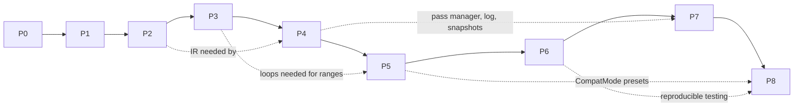

# IMPLEMENTATION_PLAN — `cpp2py` (C++ → Python translator)

| | |
|---|---|
| Document status | Draft v0.1 — written 2026-10-18 |
| Governing design | `ARCHITECTURE.md` (this plan must agree with it; section references look like "ARCH §E.5") |
| Persistent agent rules | `AGENTS.md` |
| Purpose | Phased, verifiable steps a developer or coding agent (Google Antigravity) can follow **without redesigning the architecture** |

> **Nothing below is implemented.** All phases start as `NOT STARTED`. The status table is the single source of truth for progress and may be changed only when the phase's acceptance criteria have been *run and checked* (see AGENTS.md).

## Status table

| Phase | Title | Status | Verified on | Evidence (commands run, result) |
|---|---|---|---|---|
| P0 | Architecture and repository setup | **VERIFIED** | 2026-10-23 | `python -m pytest -q` → 2 passed; `python -c "import cpp2py; print(cpp2py.__version__)"` → 0.0.0; `cpp2py/` contains only `__init__.py`; `git status` clean after commit |
| P1 | Minimal frontend and translator | **VERIFIED** | 2026-10-24 | 104 passed (pytest -q); 104 collected (>=60); all positive examples match .expected byte-identically; 15/15 error programs exit 2 with expected codes and no output file; AST dump, W6001 warning, and layering verified |
| P2 | Custom IR, AST→IR, snapshots | **VERIFIED** | 2026-10-24 | 163 passed (pytest -q); 163 collected (>=100); golden IR matches ARCH §D.4 Stage 3 character-for-character; verifier tests pass E5001; IR path equals direct backend stdout; snapshots deterministic & identical across runs; fold_demo prints 48; layering verified |
| P3 | Control flow, functions, I/O syntax | **VERIFIED** | 2026-10-24 | 243 passed (pytest -q, 84 new tests >= 70); all 14 Phase 3 examples produce byte-identical stdout to .expected; all 11 error programs exit 2 with expected code and no output file; golden while IR equals ARCH §D.4; verifier accepts all examples and rejects 7 hand-built shape violations; ast_to_python.py & --backend removed; while True fallback, shadowing, recursion verified; AC3.1–AC3.10 PASS |
| P4 | Transform framework, constant folding, logs | **VERIFIED** | 2026-10-24 | 328 passed (pytest -q, 85 new tests >= 60); fold_demo Stage 4 IR & Stage 5 Python reproduced character-for-character, stdout 48; 6 log records verified in order & replay test passes; folding table, div/mod zero & overflow W6004 verified; idempotence & fixed-point verified; E5001 invalid pass verified; AC4.1-AC4.10 PASS; optional idiomatic loops qualified/disqualified verified |
| P5 | Types, range analysis, compatibility helpers | **VERIFIED** | 2026-10-25 | 453 passed (pytest -q, 125 new tests >= 120); brute-force soundness test passes for all transfer functions (>= 10^4 pairs); exhaustive helper tests on [-50, 50]; div_no_helper_needed has 0 helpers, div_needs_helper has helpers in range_guided and always; self-consistency on all Phase 5 examples vs .expected verified; naive reproduces Phase 4; plan.json and ranges.json deterministic; default overflow policy does not wrap; analysis converges; AC5.1-AC5.10 PASS |
| P6 | Differential testing infrastructure | **VERIFIED** | 2026-10-25 | 504 passed (pytest -q, 51 new tests >= 50); in sandbox: 496 passed, 8 skipped with explicit reason; difftest curated range_guided exits 0 (40/40, 100%), naive exits 4 with 22 mismatches; difftest generated seed 1 count 200 executes 325 runs with 12 mismatches persisted to tests/regression with full snapshots; AC6.1–AC6.9 PASS |
| P7 | Failure localisation, fidelity reports | NOT STARTED | — | — |
| P8 | Baselines, evaluation, limitations | NOT STARTED | — | — |

## Phase dependency graph



Ordering rationale: range-guided compatibility (P5) needs the IR (P2), control flow (P3) and the pass/log/snapshot machinery (P4) plus defined integer semantics (ARCH §E); the differential harness (P6) needs the compatibility modes to have something to compare; localisation (P7) needs snapshots, logs and the harness; evaluation (P8) needs all of them and a reproducible test system.

## Global conventions

| Item | Rule |
|---|---|
| Python | ≥ 3.10 (Q7); standard library only at runtime; `pytest` is the single dev dependency |
| Commands (from repo root) | all tests: `python -m pytest -q`; one phase's unit tests: `python -m pytest -q tests/unit`; C++-dependent tests: `python -m pytest -q -m requires_cxx` (P6+) |
| CLI | `python -m cpp2py <subcommand> ...` |
| Examples | `examples/<phase>/<name>.cpp`, optional `<name>.in`, `<name>.expected` (stdout, byte-exact) |
| Error tests | assert diagnostic **codes** (ARCH §F.1), not message wording |
| Git | one commit (or small series) per phase; after the human re-runs the commands: tag `phase-N-verified` |
| Deviations | recorded in the "Deviations log" at the end of this file with date, reason and consequence |
| Antigravity | prompts are in each phase section. If your Antigravity version does not auto-load `AGENTS.md` (Q8), paste it at the start of the session. |

**Definition of done (every phase):** every acceptance criterion checked by running its command and reading the output; the full test suite passes (`python -m pytest -q` exit code 0); no file outside the phase's scope changed without a recorded reason; checklist and status table updated truthfully; summary lists real command results.

---

## Phase 0 — Architecture and repository setup

**1. Objective and rationale.** Fix the design before code exists, and create the smallest repository skeleton that makes Phase 1 testable. Rationale: an AI coding agent drifts unless the architecture, boundaries and acceptance tests are written down first.

**2. Dependencies and prerequisites.** None. Needs Python ≥ 3.10 and `git`. (Verified at authoring time: repository empty, no git, no earlier plan.)

**3. Exact scope and tasks.**
* P0-a (done by the documentation task): `ARCHITECTURE.md`, `IMPLEMENTATION_PLAN.md`, `AGENTS.md` exist and agree.
* P0-b (human review): read the documents; resolve or consciously defer open questions Q2, Q3, Q7, Q8 (ARCH §K.4) *before* Phase 1. Record answers in the Deviations log if they change the design.
* P0-c (scaffolding, via the prompt below): `git init` if needed; create `pyproject.toml`, `.gitignore`, `README.md`, `cpp2py/__init__.py` (only `__version__ = "0.0.0"`), `tests/test_environment.py`.

**4. Files to create.** `pyproject.toml` (name `cpp2py`, `requires-python = ">=3.10"`, **no runtime dependencies**, optional-dependency group `dev = ["pytest"]`, pytest config with `testpaths = ["tests"]` and marker `requires_cxx`), `.gitignore` (`out/`, `__pycache__/`, `.pytest_cache/`, `*.egg-info/`, virtualenv folders), `README.md` (purpose, "status: pre-implementation", how to run tests, pointer to the three documents), `cpp2py/__init__.py`, `tests/test_environment.py`.

**5. Consistency requirements.** Package name `cpp2py`; test layout and the `requires_cxx` marker as in ARCH §L; no module other than `__init__.py`.

**6. Tests.** `tests/test_environment.py`: (a) `sys.version_info >= (3, 10)`; (b) `import cpp2py` works and `cpp2py.__version__` is a string.

**7. Acceptance criteria.**
* AC0.1 `ARCHITECTURE.md`, `IMPLEMENTATION_PLAN.md`, `AGENTS.md` exist at the repo root.
* AC0.2 `python -m pytest -q` exits 0 and reports ≥ 2 passed.
* AC0.3 `python -c "import cpp2py; print(cpp2py.__version__)"` prints a version string.
* AC0.4 `pyproject.toml` declares no runtime dependencies (`dependencies = []` or absent).
* AC0.5 `git status` shows only the intended files; `out/` is ignored.
* AC0.6 `cpp2py/` contains **only** `__init__.py`.

**8. Commands.**
```bash
python --version
python -m pytest -q
python -c "import cpp2py; print(cpp2py.__version__)"
ls cpp2py
git status --short
```

**9. Excluded.** Any lexer/parser/compiler code, empty "placeholder" modules, CI configuration, packaging/publishing, example programs.

**10. Failure modes.** Tests not found (wrong `testpaths`, missing `tests/` or running from another directory); `import cpp2py` fails when running from a subdirectory (run from repo root); agent adds extra modules "for later" (AC0.6 catches it).

**11. Checklist.**
- [x] Three documents reviewed by a human; Q2, Q3, Q7, Q8 answered
- [x] Scaffolding created
- [x] AC0.1–AC0.6 checked with real command output
- [x] Status table updated (P0 → VERIFIED) with date

**12. Antigravity prompt (copy everything in the box).**

```text
You are setting up the repository skeleton for the project "cpp2py" (a C++ to Python source-to-source translator). This task is Phase 0, part P0-c only.

COMMON RULES
1. First read AGENTS.md, ARCHITECTURE.md and the "Phase 0" section of IMPLEMENTATION_PLAN.md. Inspect the repository before changing anything.
2. Implement ONLY what is listed below. Do not start later phases, do not add compiler code, and do not create placeholder or stub modules.
3. Preserve existing files. Do not edit the three design documents except the Phase 0 checklist and status row, and only after verification.
4. Write the tests listed below, run them, read the real output and fix failures.
5. Do not claim success until you have run every command in the Phase 0 "Commands" list and checked acceptance criteria AC0.1-AC0.6. Report each criterion as PASS or FAIL with the evidence. Never fabricate results.
6. If you believe the architecture must be changed, stop and explain instead of changing it silently.
7. Finish with a summary: files created, commands run with real results, open issues.

TASK
- Run git init only if there is no git repository yet.
- Create pyproject.toml: project name cpp2py, version 0.0.0, requires-python ">=3.10", NO runtime dependencies, optional dependency group "dev" containing pytest, pytest configuration with testpaths = ["tests"] and a registered marker named requires_cxx ("needs a C++ compiler").
- Create .gitignore covering out/, __pycache__/, .pytest_cache/, *.egg-info/, .venv/, venv/.
- Create README.md: one-paragraph purpose, "Status: pre-implementation (see IMPLEMENTATION_PLAN.md)", how to run tests, pointers to ARCHITECTURE.md, IMPLEMENTATION_PLAN.md, AGENTS.md.
- Create cpp2py/__init__.py containing only a docstring and __version__ = "0.0.0".
- Create tests/test_environment.py with two tests: the Python version is at least 3.10; cpp2py imports and __version__ is a str.
- Run: python --version ; python -m pytest -q ; python -c "import cpp2py; print(cpp2py.__version__)" ; ls cpp2py ; git status --short
- Verify AC0.1-AC0.6 from the plan, then tick the Phase 0 checklist items you verified. Leave "Three documents reviewed by a human" unticked; a human does that.
```

---

## Phase 1 — Minimal working frontend and translator

**1. Objective and rationale.** A realistic MVP: translate a tiny integer language — declarations, assignments, arithmetic, basic I/O — through a **lexer, parser, AST, semantic checking and Python code generation**. Rationale: it proves the toolchain end to end, establishes diagnostics and spans (needed by every later phase) and produces the first runnable tests, without IR or analysis.

**2. Dependencies and prerequisites.** Phase 0 `VERIFIED`; Q2, Q3, Q7 answered. **No later phase is needed.** (There is deliberately no IR, no range analysis and no helper library in this phase.)

**3. Exact scope and tasks.**

*Language accepted (everything else is rejected with the listed code):*

| Accepted | Notes |
|---|---|
| `#include <iostream>` lines; optional `using namespace std;` | other `#include` → E4003; other `#` directives → E1005 |
| exactly one function: `int main() { ... }` | other function names/params → E4001; no `main` → E2001 |
| `int` declarations `int x;`, `int x = expr;`, `int a, b = 2, c;` | all variables are `int`; other types → E4002 (`float double char bool long short unsigned signed void`) |
| assignment `x = expr;` | compound assignment, `++`, `--` → E4001 |
| expressions: decimal integer literals, names, unary `-`/`+`, binary `+ - * / %`, parentheses | literal > `INT_MAX` → E1004; comparisons/logical/bitwise/ternary → E4001 |
| `cin >> a >> b;` / `std::cin >> ...` | |
| `cout << item << item ...;` where item = expression, string literal, or `endl` (all optionally `std::`-qualified) | escapes `\n \t \\ \"` only |
| `return 0;` as the **last** statement of `main` (optional) | any other `return` → E4001 |
| `//` and `/* */` comments | unterminated block comment → E1003 |

Rejected with E4001 and a message naming the construct: `if else while for do switch break continue goto` (planned for Phase 3 or excluded), nested `{ }` blocks, `&&` `||` `!`, relational operators, `++` `--`, compound assignment operators, `class struct new delete template const static auto`, `?` `:`.

*Semantic rules:* declarations before use (E3001); no redeclaration in the single function scope (E3002); reading a variable before it has definitely been assigned, checked in straight-line order (E3003); assignment target must be a declared variable (E3005); `cin`/`cout`/`endl` need `std::` or `using namespace std;` (E3001) and cannot be redeclared (E3002); invalid `>>`/`<<` chains (E3009).

*Code generation rules (bootstrap path, ARCH D6):* AST → Python text directly.
* Layout: header comments, `import sys`, optional input prelude, `def main():`, `return 0`, `if __name__ == "__main__": sys.exit(main())`, two blank lines between top-level blocks (PEP 8).
* `int x;` (no initialiser) emits nothing; `int x = e;` and `x = e;` emit `x = e`.
* Input: prelude `_tokens = iter(sys.stdin.read().split())` (only if the program reads input); each target emits `x = int(next(_tokens))`.
* Output: `cout << a << "s" << endl;` → `print(a, "s", sep="")`; a trailing `endl` becomes the default newline; otherwise `end=""`; an `endl` that is not last becomes the string item `"\n"`; `cout << endl;` alone is `print()`. A string item containing `\n` is emitted as a Python string literal with the same escape.
* Expressions: precedence-aware printer (`codegen/pyexpr.py`); `/` → `//`, `%` → `%`; right operand of a left-associative operator gets parentheses when it has the same precedence; unary minus over a non-atom gets parentheses; `+x` emits `x`.
* Names: `NameMangler` appends `_` to Python keywords, built-in names, `sys`, `main`, `_tokens` and names starting with `_cpp`; collisions after mangling are resolved by appending further `_`.
* **Visible compatibility notice:** every generated file starts with `# Generated by cpp2py <version> (naive integer semantics: no overflow modelling)`. Each `/` and `%` additionally produces warning `W6001` (stderr, and a `# WARNING W6001 line:col ...` header comment) because Python's floor division and remainder differ from C++ for negative operands. Phase 5 replaces this with range-guided handling.
* The final text is passed to `compile()`; failure is `E9001`.

*Tasks:* source/spans; diagnostics (with caret rendering); minimal config; lexer; AST nodes + AST printer; recursive-descent parser with error recovery at `;`/`}`; semantic analyzer; name mangler; expression printer; AST→Python generator; compiler orchestration; CLI.

**4. Files to create or modify.**
`cpp2py/{source,diagnostics,config,compiler,cli,__main__}.py`; `cpp2py/frontend/{__init__,tokens,lexer,ast_nodes,parser,ast_printer}.py`; `cpp2py/semantics/{__init__,types,symbols,analyzer}.py`; `cpp2py/codegen/{__init__,names,pyexpr,ast_to_python}.py`; `tests/conftest.py`; `tests/unit/test_{source,diagnostics,lexer,parser,ast_printer,semantics,names,pyexpr,codegen}.py`; `tests/integration/test_{examples,cli}.py`; `examples/phase1/*` (listed below). Modify `README.md` (usage) only.

**5. Design decisions and interfaces to keep consistent with ARCH.**
`tokenize(source, sink)`, `parse(tokens, sink)`, `analyze(program, config, sink)`, `compile_source(text, filename, config)`; `Diagnostic`/`DiagnosticSink` and the code registry of ARCH §F.1; AST nodes of ARCH §D.2 (those tagged P1); immutable AST with side-table `SemanticInfo`; layering of ARCH §C.1 (`frontend` imports nothing above it); `TargetModel(int_bits=32)` as the only config content; `CompilationResult` containing at least `success`, `python_source`, `diagnostics`, `ast`.

**6. Tests and example programs to add.**

Unit tests (minimum counts): source/spans 3; diagnostics 3; lexer 12 (every token kind, `<<` vs `<`, comments, string escapes, literal range, bad character, unterminated string/comment, include handling); parser 15 (each statement form, precedence, associativity, parentheses, unary minus, output chains, each unsupported construct → E4001, missing `;`, recovery reports ≥ 2 errors in one file); AST printer 2 (golden); semantics 12 (each E3xxx rule plus valid cases); names 4; pyexpr 8 (`a-(b-c)`, `a-b-c`, `-(a+b)`, `-(-x)`, `a*(b+c)%d`, `a/(b/c)`, `+x`, nested); codegen 10 (layout, input prelude only when needed, output forms, header/warning comments, name mangling, `compile()` success). **Total collected tests ≥ 60.**

Examples (`examples/phase1/`; expected stdout shown as `⏎` = newline):

| File | Content | Stdin | Expected stdout |
|---|---|---|---|
| `arith_basic.cpp` | `a=10, b=3`, prints `a+b`, `a*b`, `a-b` each with `endl` | — | `13⏎30⏎7⏎` |
| `read_sum.cpp` | `int x, y; cin >> x >> y; cout << "sum = " << x + y << endl;` | `20 22⏎` | `sum = 42⏎` |
| `precedence.cpp` | `a=2+3*4; b=(2+3)*4; c=20-5-3; d=20-(5-3); e=100/5/2; f=100/(5/2);` printed space-separated | — | `14 20 12 18 10 50⏎` |
| `unary_and_mod.cpp` | `a=17; b=-a; c=-(a+3); r=a%5;` printed with `"\n"` | — | `-17⏎-20⏎2⏎` |
| `reassign.cpp` | `x=1; x=x+1; x=x*10; int y; y=x-5;` prints `x`, space, `y` | — | `20 15⏎` |
| `output_forms.cpp` | `cout << "Hello" << endl; cout << "a" << 1 << "b" << 2 << "\n"; cout << 7;` | — | `Hello⏎a1b2⏎7` (no final newline) |
| `qualified_names.cpp` | no `using`; `std::cin >> n; std::cout << n * 2 << std::endl;` | `21⏎` | `42⏎` |
| `multi_decl.cpp` | `int a = 1, b = 2, c; c = a + b;` prints `c` | — | `3⏎` |
| `empty_main.cpp` | `int main() { }` | — | *(empty)* |
| `names_python_keywords.cpp` | variables named `lambda`, `print`, `class_`… (valid C++ names that clash with Python) | — | author-chosen, hand-verified |
| `neg_division_warning.cpp` | `int a = -7; cout << a / 2 << endl;` | — | **not asserted** (documents the W6001 divergence); test asserts exit status 0 and presence of W6001 |

Rejected programs (`examples/phase1/errors/`, each must exit 2, write no output file, and report the code in brackets): `undeclared_var` [E3001], `redeclared` [E3002], `use_before_init` [E3003], `missing_semicolon` [E2002], `unsupported_float` [E4002], `unsupported_while` [E4001], `unsupported_header` (`#include <vector>`) [E4003], `unsupported_directive` (`#define X 1`) [E1005], `literal_too_big` (`2147483648`) [E1004], `bad_char` (`@`) [E1001], `return_value` (`return 1;`) [E4001], `no_main` [E2001], `unterminated_string` [E1002], `nested_block` [E4001], `compound_assign` [E4001].

**7. Acceptance criteria (objectively verifiable).**
* AC1.1 `python -m pytest -q` exits 0; `python -m pytest --collect-only -q` reports ≥ 60 tests.
* AC1.2 For every example with an `.expected` file, translating with the CLI and running the generated Python (with `.in` as stdin when present) yields stdout byte-identical to `.expected` and exit status 0 (an integration test does this for all of them).
* AC1.3 For every program in `errors/`, the CLI exits with status 2, stderr contains the expected code, and the `-o` file does not exist afterwards.
* AC1.4 Every generated file passes `compile()` (asserted in tests) and starts with the `# Generated by cpp2py` notice.
* AC1.5 `neg_division_warning.cpp` produces `W6001` on stderr and a `# WARNING W6001` header comment in the output; exit status 0.
* AC1.6 `--dump-ast` prints the AST dump (golden test) and does not write Python.
* AC1.7 Parser reports ≥ 2 distinct errors for a file with two independent syntax errors (recovery test).
* AC1.8 Layering: `grep -rn "cpp2py.ir\|cpp2py.transforms\|cpp2py.analysis\|cpp2py.compat\|cpp2py.testing" cpp2py` prints nothing, and `cpp2py/` contains no `ir/`, `transforms/`, `analysis/`, `compat/` directory.
* AC1.9 `pyproject.toml` has no runtime dependencies; `python -m cpp2py --version` prints the version.
* AC1.10 Precedence tests prove: `20-5-3` → 12, `20-(5-3)` → 18, `-(17+3)` → -20, `100/(5/2)` → 50 when executed.

**8. Commands.**
```bash
python -m pytest -q
python -m pytest --collect-only -q | tail -n 3
python -m cpp2py translate examples/phase1/arith_basic.cpp -o out/arith_basic.py && python out/arith_basic.py
python -m cpp2py translate examples/phase1/read_sum.cpp -o out/read_sum.py && python out/read_sum.py < examples/phase1/read_sum.in
python -m cpp2py translate examples/phase1/neg_division_warning.cpp -o out/neg.py ; head -n 6 out/neg.py
python -m cpp2py translate examples/phase1/errors/undeclared_var.cpp -o out/bad.py ; echo "exit=$?" ; ls out/bad.py
python -m cpp2py translate --dump-ast examples/phase1/arith_basic.cpp
grep -rn "cpp2py.ir\|cpp2py.transforms\|cpp2py.analysis\|cpp2py.compat\|cpp2py.testing" cpp2py
```
(On Windows replace `grep -rn` with `findstr /s /n`.)

**9. Explicitly excluded.** IR of any kind; `if`/`while`/`for`; functions other than `main`; `return` other than a final `return 0;`; compound assignment, `++/--`; nested blocks; relational operators; `long long` and other types; constant folding or any optimisation; range analysis; compatibility helpers (`_cpp_div` etc.); differential testing against `g++`; snapshots; transformation logs; reports.

**10. Failure modes and detection.**

| Failure | Detection |
|---|---|
| `a - (b - c)` printed without parentheses | pyexpr tests, `precedence.cpp` |
| `<<`/`>>` mis-lexed as two `<`/`>` | lexer tests |
| Python name collisions (`print`, `lambda`) | `names_python_keywords.cpp` |
| Generated file has no trailing newline / wrong exit status | integration tests compare stdout bytes and exit codes |
| Partial output written on error | AC1.3 |
| `\r\n` line endings in sources break spans or string literals | lexer test with CRLF input |
| Agent silently adds `while` or IR | AC1.8 and "excluded" review |
| Warnings only on stderr, lost in files | AC1.5 header-comment check |

**11. Checklist.**
- [x] Source, diagnostics, config, lexer, AST, parser, semantics, codegen, compiler, CLI implemented
- [x] ≥ 60 tests, all passing
- [x] All examples and error programs behave as specified
- [x] AC1.1–AC1.10 checked with real command output
- [x] README usage updated; status table updated (P1 → VERIFIED) with date

**12. Antigravity prompt (copy everything in the box; it does not depend on any earlier conversation).**

```text
You are implementing PHASE 1 of the project "cpp2py": a Python program that translates a small subset of C++ into readable Python. The repository already contains ARCHITECTURE.md, IMPLEMENTATION_PLAN.md, AGENTS.md, pyproject.toml, cpp2py/__init__.py and tests/test_environment.py (Phase 0). The authoritative detail is in the "Phase 1" section of IMPLEMENTATION_PLAN.md and in ARCHITECTURE.md; this prompt repeats everything you need so you can work from it directly. If the repository and this prompt disagree, stop and tell me.

COMMON RULES
1. First read AGENTS.md, ARCHITECTURE.md (sections A, B, C, D, F) and the "Phase 1" section of IMPLEMENTATION_PLAN.md. Inspect the existing repository before changing anything.
2. Implement ONLY Phase 1. Do not start later phases. Do not create an IR, transformation, analysis, compat or testing package. Do not add placeholder or stub modules for later phases. Do not silently widen the C++ subset.
3. Preserve existing working code. No unrelated refactoring.
4. Write tests alongside each feature. Run them, read the real output, fix failures.
5. Do not claim success until you have run every command in the "Commands" list below and checked every acceptance criterion. Report each criterion as PASS or FAIL with evidence. Never fabricate test results or claim unimplemented functionality.
6. If the architecture must be deviated from, stop, explain why, and record it in the "Deviations log" at the end of IMPLEMENTATION_PLAN.md.
7. Update the Phase 1 checklist and status row in IMPLEMENTATION_PLAN.md only for items you actually verified.
8. Finish with a summary: files created or changed, tests added, commands run with their real results, open issues.

GOAL
Pipeline: C++ text -> lexer -> parser -> AST -> semantic analysis -> Python code generation (directly from the AST; there is NO IR in this phase). Use only the Python standard library (pytest for tests). Python >= 3.10.

LANGUAGE ACCEPTED
- "#include <iostream>" lines (any other #include -> error E4003; any other # directive -> E1005). Optional "using namespace std;".
- Exactly one function: "int main() { ... }". A different function name or parameters -> E4001. No main -> E2001.
- Declarations of type int only: "int x;", "int x = expr;", "int a, b = 2, c;". Other types (float double char bool long short unsigned signed void) -> E4002.
- Assignment statements "x = expr;" (plain "=" only).
- Expressions: decimal integer literals (must fit 32-bit int, else E1004; there are no suffixes), variable names, unary - and +, binary + - * / %, parentheses. Left-associative, C++ precedence.
- Input: "cin >> a >> b;" or "std::cin >> a;".
- Output: "cout << item << item;" where item is an expression, a string literal (escapes \n \t \\ \" only), or endl; "std::" prefix optional.
- "return 0;" allowed only as the LAST statement of main. Any other return -> E4001.
- Comments // and /* */ (unterminated block comment -> E1003).
- Recognise and reject with E4001 (message: "unsupported construct '<name>' (not supported in this version)"): if else while for do switch break continue goto, nested { } blocks, && || !, < > <= >= == !=, ++ --, += -= *= /= %=, ? :, class struct new delete template const static auto.
- Other lexical errors: invalid character E1001, unterminated string E1002. Syntax errors: unexpected token E2001, missing semicolon E2002, unbalanced braces/parentheses E2003.

SEMANTIC RULES (analyzer)
- E3001 undeclared identifier (also cin/cout/endl used without std:: or "using namespace std;").
- E3002 redeclaration in the function scope; cin, cout, endl, std, main cannot be declared as variables.
- E3003 a variable is read before it has definitely been assigned (straight-line order; "cin >> x" assigns x).
- E3005 assignment/input target is not a declared variable.
- E3009 invalid cin/cout chain (e.g. "cin << x").
- Keep the AST immutable; store results in a SemanticInfo side table keyed by node id.

CODE GENERATION RULES
- Output file layout, in order: header comment lines; "import sys"; if the program reads input: "_tokens = iter(sys.stdin.read().split())"; two blank lines; "def main():" with the translated body (the body always ends with "return 0"; an empty body is just "return 0"); two blank lines; 'if __name__ == "__main__":' then "    sys.exit(main())".
- First line of every output: "# Generated by cpp2py <version> (naive integer semantics: no overflow modelling)".
- "int x;" emits nothing. "int x = e;" and "x = e;" emit "x = <e>". "cin >> x;" emits "x = int(next(_tokens))" (one line per target).
- "cout << a << "s" << endl;" emits print(a, "s", sep=""). A final endl is the print default newline; with no final endl use end="". An endl that is NOT last is emitted as the string item "\n". "cout << endl;" alone emits print(). Emit string literals as Python string literals with the same escapes.
- Expression printer in codegen/pyexpr.py: "/" -> "//", "%" -> "%"; parenthesize the RIGHT operand of a binary operator when it has the same precedence as the operator; parenthesize the operand of unary minus when it is not a literal or a name; never emit "--x"; unary plus is dropped. "a - (b - c)" must stay "a - (b - c)"; "a - b - c" must stay "a - b - c".
- Name mangling (codegen/names.py): append "_" to Python keywords, names in dir(builtins), "sys", "main", "_tokens", and names starting with "_cpp"; if the mangled name collides with another variable, append more "_".
- Every "/" and "%" in the source produces warning W6001 ("'/' is emitted as Python floor division; the result differs from C++ when an operand is negative" and the same for '%'). Print warnings to stderr AND add one header comment per warning: "# WARNING W6001 <line>:<col>: ...".
- Run compile(generated_text, "<generated>", "exec") before writing; failure is internal error E9001 (exit status 3).

CLI
- python -m cpp2py translate INPUT.cpp [-o OUTPUT.py] [--dump-ast]
- Python goes to OUTPUT.py, or to stdout if -o is omitted. Diagnostics go to stderr formatted "file:line:col: error E3001: message" followed by the source line and a caret.
- --dump-ast prints a tree dump of the AST to stdout and generates no Python.
- python -m cpp2py --version prints the version.
- Exit status: 0 success; 1 usage or I/O error; 2 source rejected (any ERROR diagnostic; then NO output file is written); 3 internal error.
- Parser recovery: after a syntax error, skip to the next ";" or "}" so several errors can be reported (report at most 20). Never pass a recovered AST to later stages.

FILES TO CREATE
cpp2py/source.py, diagnostics.py, config.py (TargetModel(int_bits=32) and CompilerConfig(target) only), compiler.py (compile_source(text, filename, config=None) -> CompilationResult with success, python_source, diagnostics, ast), cli.py, __main__.py
cpp2py/frontend/__init__.py, tokens.py, lexer.py, ast_nodes.py, parser.py, ast_printer.py
cpp2py/semantics/__init__.py, types.py, symbols.py, analyzer.py
cpp2py/codegen/__init__.py, names.py, pyexpr.py, ast_to_python.py
tests/conftest.py (helper that runs a generated Python file with given stdin), tests/unit/test_*.py, tests/integration/test_examples.py, tests/integration/test_cli.py, examples/phase1/...
Also update README.md with usage. Layering rule: frontend must not import semantics, codegen or compiler; semantics must not import codegen.

EXAMPLES TO CREATE in examples/phase1/ (expected stdout in .expected files, byte exact; "NL" means newline)
- arith_basic.cpp: a=10, b=3; print a+b, a*b, a-b each followed by endl. Expected: 13 NL 30 NL 7 NL
- read_sum.cpp (+ read_sum.in containing "20 22" NL): int x, y; cin >> x >> y; cout << "sum = " << x + y << endl; Expected: sum = 42 NL
- precedence.cpp: a=2+3*4; b=(2+3)*4; c=20-5-3; d=20-(5-3); e=100/5/2; f=100/(5/2); print them separated by single spaces, then endl. Expected: 14 20 12 18 10 50 NL
- unary_and_mod.cpp: a=17; b=-a; c=-(a+3); r=a%5; print b, c, r each followed by "\n". Expected: -17 NL -20 NL 2 NL
- reassign.cpp: x=1; x=x+1; x=x*10; int y; y=x-5; print x, a space, y, endl. Expected: 20 15 NL
- output_forms.cpp: cout << "Hello" << endl; cout << "a" << 1 << "b" << 2 << "\n"; cout << 7; Expected: Hello NL a1b2 NL 7 (NO final newline)
- qualified_names.cpp (+ .in "21" NL): no using-directive; std::cin >> n; std::cout << n * 2 << std::endl; Expected: 42 NL
- multi_decl.cpp: int a = 1, b = 2, c; c = a + b; print c with endl. Expected: 3 NL
- empty_main.cpp: int main() { } Expected: empty output
- names_python_keywords.cpp: variables named lambda, print, class_, def, None_ etc; derive the expected output by hand and double-check it.
- neg_division_warning.cpp: int a = -7; cout << a / 2 << endl; (do NOT assert the output value; assert exit status 0 and the W6001 warning)
- examples/phase1/errors/*.cpp, each must exit 2 with the code in brackets: undeclared_var [E3001], redeclared [E3002], use_before_init [E3003], missing_semicolon [E2002], unsupported_float [E4002], unsupported_while [E4001], unsupported_header ("#include <vector>") [E4003], unsupported_directive ("#define X 1") [E1005], literal_too_big (2147483648) [E1004], bad_char ("@") [E1001], return_value ("return 1;") [E4001], no_main [E2001], unterminated_string [E1002], nested_block [E4001], compound_assign [E4001].

TESTS (minimum counts; total collected tests must be >= 60)
source 3; diagnostics 3; lexer 12 (all token kinds, << versus <, comments, string escapes, literal range, bad char, unterminated string and comment, include handling, CRLF input); parser 15 (each statement form, precedence, associativity, parentheses, unary minus, output chains, each unsupported construct, missing semicolon, recovery reports >= 2 errors); AST printer 2 (golden); semantics 12; names 4; pyexpr 8 (a-(b-c), a-b-c, -(a+b), -(-x), a*(b+c)%d, a/(b/c), +x, nesting); codegen 10 (layout, input prelude only when needed, output forms, header and warning comments, mangling, compile() success); integration: every example with an .expected file is translated by the CLI, executed with Python (stdin from .in if present) and compared byte for byte; every errors/ program is checked for exit status 2, the expected code on stderr, and that the -o file does not exist.

ACCEPTANCE CRITERIA (check each one)
AC1.1 python -m pytest -q exits 0 and collects >= 60 tests.
AC1.2 All examples with .expected files produce byte-identical stdout and exit status 0.
AC1.3 All errors/ programs: exit status 2, expected code on stderr, no output file.
AC1.4 Every generated file passes compile() and starts with the "# Generated by cpp2py" line.
AC1.5 neg_division_warning.cpp: W6001 on stderr and a "# WARNING W6001" header comment; exit 0.
AC1.6 --dump-ast prints the AST (golden test) and writes no Python.
AC1.7 A file with two independent syntax errors reports >= 2 errors.
AC1.8 grep -rn "cpp2py.ir\|cpp2py.transforms\|cpp2py.analysis\|cpp2py.compat\|cpp2py.testing" cpp2py prints nothing; no ir/, transforms/, analysis/, compat/ directories exist.
AC1.9 pyproject.toml has no runtime dependencies; python -m cpp2py --version works.
AC1.10 Executed precedence tests prove 20-5-3 = 12, 20-(5-3) = 18, -(17+3) = -20, 100/(5/2) = 50.

COMMANDS TO RUN BEFORE REPORTING
python -m pytest -q
python -m pytest --collect-only -q | tail -n 3
python -m cpp2py translate examples/phase1/arith_basic.cpp -o out/arith_basic.py && python out/arith_basic.py
python -m cpp2py translate examples/phase1/read_sum.cpp -o out/read_sum.py && python out/read_sum.py < examples/phase1/read_sum.in
python -m cpp2py translate examples/phase1/neg_division_warning.cpp -o out/neg.py ; head -n 6 out/neg.py
python -m cpp2py translate examples/phase1/errors/undeclared_var.cpp -o out/bad.py ; echo "exit=$?" ; ls out/bad.py
python -m cpp2py translate --dump-ast examples/phase1/arith_basic.cpp
grep -rn "cpp2py.ir\|cpp2py.transforms\|cpp2py.analysis\|cpp2py.compat\|cpp2py.testing" cpp2py

EXPLICITLY OUT OF SCOPE (do not implement, do not stub): IR, if/while/for, other functions or return forms, compound assignment, ++/--, nested blocks, comparisons, long long, optimisation or constant folding, range analysis, compatibility helpers, differential testing with g++, snapshots, logs, reports.

Do not report success until every command above has been run and every acceptance criterion has been checked and reported as PASS or FAIL with evidence.
```


---

## Phase 2 — Custom IR, AST-to-IR generation, readable IR output and snapshots

**1. Objective and rationale.** Introduce the IR as a distinct representation (ARCH §D.3), generate it from the Phase 1 language, print it readably, verify it, snapshot it, and move Python generation onto it. Rationale: every later feature (control flow, passes, ranges, localisation) attaches to the IR. The IR data model and verifier are built for the *whole* opcode set now so that Phase 3 adds emission, not a redesign.

**2. Dependencies and prerequisites.** Phase 1 `VERIFIED`. Needs the Phase 1 AST, `SemanticInfo`, diagnostics and bootstrap generator. No later phase is needed.

**3. Exact scope and tasks.**
* `ir/model.py`: `IdAllocator` (op ids `op_<n>`, temps `t<n>`, regions `r<n>`; monotonic, never reused), IR types (`i32`, `i64`, `bool`, `void`, `str`), operands (`Const`, `VarRef`, `TempRef`, `StrConst`), `Opcode` enum with **all opcodes of ARCH §D.3.4 except `cast`**, `Instruction`, `IRFunction`, `IRModule`, `RegionInfo`.
* `ir/builder.py`: lower the Phase 1 language: `DeclStmt` → `declare` (+ `assign` for an initialiser); `AssignStmt` → `assign`; `InputStmt` → one `read` per target; `OutputStmt` → one `print` (a non-final `endl` becomes `StrConst("\n")`; a final `endl` sets the `newline` flag); arithmetic → `binop`/`unop` with fresh temps, left operand evaluated before right; `return` → `return`; if `main` has no `return`, append `return 0` with the span of the closing brace. Every instruction gets the span of its source node (statement span for `declare/assign/read/print/return`, start of the operator expression for `binop/unop`).
* `ir/printer.py`: the textual format of ARCH §D.3.7, deterministic; `--dump-ir`.
* `ir/verifier.py`: invariants of ARCH §D.3.8 (including label/branch/jump and canonical-shape checks, exercised with hand-built IR since the builder does not emit control flow yet). Returns diagnostics with code `E5001`.
* `ir/snapshots.py`: `SnapshotStore` writing `<NN>_<stage>.ir.txt`, `.ir.json`, `output.py`, and a **timestamp-free** `manifest.json` (tool version, source SHA-256, config incl. `TargetModel`, stage list). Stages in this phase: `00_ir_initial`, `01_ir_final`.
* `codegen/python_gen.py`: IR → Python. Same layout, header, `W6001` warnings and name mangling as Phase 1 (reuse `names.py`, `pyexpr.py`). **Temp inlining rule:** inline a temporary into its single use when every instruction between definition and use is another temporary definition that is itself inlined; otherwise assign it to a Python local.
* `compiler.py`: default pipeline is now AST → IR → Python. Keep the bootstrap generator selectable with a hidden `--backend direct` option **only as a cross-check until Phase 3**.
* CLI: `--dump-ir`, `--snapshots DIR`.

**4. Files to create or modify.** Create `cpp2py/ir/{__init__,model,builder,printer,verifier,snapshots}.py`, `cpp2py/codegen/python_gen.py`, `tests/unit/test_ir_{model,builder,printer,verifier,snapshots}.py`, `tests/unit/test_python_gen.py`, `tests/unit/test_layering.py`, `tests/integration/test_ir_pipeline.py`, `examples/worked/fold_demo.cpp` (+ `.expected` = `48⏎`), `examples/phase2/*` as needed. Modify `compiler.py`, `cli.py`, `config.py` (add `snapshot_dir`), `README.md`.

**5. Consistency requirements.** Opcode names, operand classes, op-id/label naming and text format exactly as ARCH §D.3; IR carries C++ semantics (`div` = truncating) even though Python output is still naive; `ir.model` imports nothing from `frontend`/`semantics`; only `ir.builder` imports AST/`SemanticInfo`; `CompilationResult` gains `ir`.

**6. Tests and examples to add.** ≥ 40 new tests: model (IDs monotonic/unique/never reused; operand equality; text of every opcode form) 8; builder (each statement form, evaluation order, spans, implicit `return 0`, temp numbering) 12; printer (golden files) 6; verifier ≥ 12 (valid IR accepted; invalid rejected: duplicate op id, temp used before definition, temp defined twice, undeclared variable, operand type mismatch, `bool` outside `branch`, jump to missing label, duplicate label, return type mismatch, non-canonical control-flow shape, branch on non-bool, label region mismatch); snapshots 5 (files present, determinism, manifest content); python_gen 8; layering 1; integration: all Phase 1 examples through the IR path.

**7. Acceptance criteria.**
* AC2.1 `python -m pytest -q` exits 0 with ≥ 100 tests collected in total.
* AC2.2 `--dump-ir` on `examples/worked/fold_demo.cpp` equals, character for character, the Stage 3 text of ARCH §D.4 (the golden file is checked in and compared).
* AC2.3 The verifier accepts the builder output of every Phase 1 example and rejects each of the ≥ 12 hand-built invalid IR cases with `E5001`.
* AC2.4 For every Phase 1 example the IR path and `--backend direct` produce identical stdout (equal to `.expected`).
* AC2.5 Running `translate --snapshots D` twice yields byte-identical snapshot files (including `manifest.json`).
* AC2.6 Snapshot directory contains `00_ir_initial.ir.txt/.json`, `01_ir_final.ir.txt/.json`, `output.py`, `manifest.json`.
* AC2.7 `fold_demo.cpp` generates Python equal to the unfolded variant (`a = 6 * 7`, `b = a + 2 * 3`) and prints `48`.
* AC2.8 `tests/unit/test_layering.py` passes (no forbidden import directions per ARCH §C.1; `ir.model` imports no frontend/semantics module).
* AC2.9 No `transforms/`, `analysis/`, `compat/` directories; no pass/folding code; the builder emits no `label/jump/branch/cmp/call`.

**8. Commands.**
```bash
python -m pytest -q
python -m cpp2py translate --dump-ir examples/worked/fold_demo.cpp
python -m cpp2py translate examples/worked/fold_demo.cpp --snapshots out/snap1 -o out/fold.py && python out/fold.py
python -m cpp2py translate examples/worked/fold_demo.cpp --snapshots out/snap2 -o out/fold2.py
diff -r out/snap1 out/snap2 && echo "snapshots identical"
python -m cpp2py translate examples/phase1/precedence.cpp --backend direct -o out/p_direct.py && python out/p_direct.py
python -m cpp2py translate examples/phase1/precedence.cpp -o out/p_ir.py && python out/p_ir.py
```

**9. Excluded.** Emission of control flow/calls, `cast`, transformations of any kind (including constant folding), range analysis, compatibility helpers, differential testing, logs.

**10. Failure modes.** Temp numbering instability (golden mismatch); wrong evaluation order; spans pointing at the wrong column (golden spans); inlining a temp across a variable write (add a test with `x = x + 1` patterns); non-deterministic snapshots (dict ordering, timestamps); accidentally importing AST types into `ir.model`.

**11. Checklist.**
- [x] IR model, builder, printer, verifier, snapshots implemented
- [x] IR-based generator is the default; bootstrap path still selectable
- [x] ≥ 40 new tests, all passing; layering test in place
- [x] AC2.1–AC2.9 checked with real output; status table updated (P2 → VERIFIED)

**12. Antigravity prompt.**

```text
You are implementing PHASE 2 of the project "cpp2py". Phase 1 (lexer, parser, AST, semantic analysis, AST-to-Python generator) is already in the repository and verified.

COMMON RULES
1. First read AGENTS.md, ARCHITECTURE.md (sections B, C, D, F, G) and the "Phase 2" section of IMPLEMENTATION_PLAN.md. Inspect the existing code before changing anything.
2. Implement ONLY Phase 2. Do not start Phase 3 or later. Do not add control-flow emission, transformations, constant folding, range analysis, compat helpers or differential testing. No placeholder or stub modules for later phases. Do not widen the supported C++ subset.
3. Preserve existing working code; no unrelated refactoring. The Phase 1 AST-to-Python generator must keep working and stay selectable with a hidden "--backend direct" option.
4. Write tests with each feature, run them, read the real output, fix failures.
5. Do not claim success until you have run every command in the Phase 2 "Commands" list and checked acceptance criteria AC2.1-AC2.9, reporting each as PASS or FAIL with evidence. Never fabricate results.
6. If the architecture must be deviated from, stop, explain, and record it in the Deviations log of IMPLEMENTATION_PLAN.md.
7. Update the Phase 2 checklist and status row only for items you verified.
8. Finish with a summary: files changed, tests added, real command results, open issues.

TASK
Implement the IR layer exactly as specified in ARCHITECTURE.md section D.3 and the Phase 2 section of IMPLEMENTATION_PLAN.md:
- cpp2py/ir/model.py (IdAllocator; types i32/i64/bool/void/str; operands Const/VarRef/TempRef/StrConst; Opcode enum with every opcode of D.3.4 except cast; Instruction with op_id, opcode, dst, operands, span, origin; IRFunction; IRModule; RegionInfo). ir.model must not import frontend or semantics.
- cpp2py/ir/builder.py: lower the Phase 1 language (declare/assign/read/print/binop/unop/return). Left operand before right. A non-final endl becomes StrConst("\n"); a final endl sets the print newline flag. Append "return 0" (span of the closing brace) if main has none. The IR keeps C++ semantics: "/" is binop div and "%" is binop mod.
- cpp2py/ir/printer.py: deterministic text format of D.3.7. The worked example in D.4 stage 3 must be reproduced character for character, including spans (examples/worked/fold_demo.cpp; expected stdout 48).
- cpp2py/ir/verifier.py: all invariants of D.3.8, including labels, jumps, branches and canonical shapes, tested with hand-built IR; report code E5001.
- cpp2py/ir/snapshots.py: SnapshotStore writing 00_ir_initial and 01_ir_final as .ir.txt and .ir.json, output.py and a manifest.json WITHOUT timestamps (tool version, SHA-256 of source, config including target model, stage list). Output must be byte-identical across runs.
- cpp2py/codegen/python_gen.py: IR to Python with the same layout, header, W6001 warnings and name mangling as Phase 1 (reuse names.py and pyexpr.py). Inline a temp into its single use only if every instruction between definition and use is another temp definition that is itself inlined.
- compiler.py: default pipeline AST -> IR -> Python. CLI: --dump-ir, --snapshots DIR, hidden --backend direct.
- tests: >= 40 new tests (model 8, builder 12, printer 6, verifier >= 12 including the invalid cases: duplicate op id, temp used before definition, temp defined twice, undeclared variable, type mismatch, bool outside branch, jump to a missing label, duplicate label, return type mismatch, non-canonical control-flow shape, branch on a non-bool, label region mismatch; snapshots 5; python_gen 8), tests/unit/test_layering.py (import-direction scan per ARCHITECTURE.md C.1), integration test running every Phase 1 example through the IR path and comparing stdout with the direct backend and with .expected.
Out of scope: emitting label/jump/branch/cmp/call from the builder, cast, any pass, any analysis.

ACCEPTANCE CRITERIA: AC2.1 - AC2.9 as listed in the Phase 2 section of IMPLEMENTATION_PLAN.md (>= 100 tests total; golden IR equals ARCH D.4 stage 3; verifier accepts all builder output and rejects each invalid case with E5001; IR path equals direct backend stdout on all Phase 1 examples; snapshots deterministic; snapshot files present; fold_demo output 48 and unfolded Python; layering test passes; no later-phase directories).

COMMANDS TO RUN: the list in the Phase 2 section (pytest; --dump-ir; two --snapshots runs and diff -r; direct versus IR backend on precedence.cpp).

Do not report success until every command has been run and every criterion checked.
```

---

## Phase 3 — Extend language support: control flow, functions, return, agreed I/O syntax

**1. Objective and rationale.** Make the translator useful on realistic small programs: `if/else`, `while`, `for`, compound assignment and `++/--`, relational conditions, functions with parameters and return values, recursion. Rationale: range analysis (Phase 5) is only interesting with loops and conditions, and the IR was designed for this in Phase 2.

**2. Dependencies and prerequisites.** Phase 2 `VERIFIED`. Q5 (`&&`/`||`) answered — this plan assumes they stay excluded (ARCH D8).

**3. Exact scope and tasks.**
* **Front end:** tokens/parser/AST for `if/else if/else`, `while`, `for`, compound assignment `+= -= *= /= %=`, `++/--` as statements and in `for` updates, relational conditions (`Condition` node — only inside `if/while/for`), function definitions (return `int`/`void`, `int` by-value parameters), call expressions and call statements, general `return`, nested blocks. Still rejected (E4001): `&& || ! ? : break continue do switch goto`, prototypes, global variables, expression-position assignment or `++`. A `for` without a condition → E2001.
* **Semantics:** scope stack (nested blocks may shadow); **definite assignment over control flow** (conservative: assigned after an `if` only if assigned on both branches; assignments inside loop bodies do not count after the loop; `for` init counts); function table with definition-before-use (a function is visible inside its own body, enabling recursion); argument count/type check (E3006/E3004); `void` function result cannot be used (E3004); missing `return` on some path of a non-`void` function (E3007; `main` is exempt); relational expression as value (E3008); duplicate function names (E3002); `main` must be `int main()` with no parameters.
* **IR builder:** emit canonical shapes of ARCH §D.3.6 with regions, labels (`role`, `region_id`) and `RegionInfo` (for `for`: `loop_var`); `cmp`, `branch`, `jump`, `call`; lower `for` to init + loop shape (update before the back jump); give shadowed variables unique `ir_name`s (`x`, `x_1`, …) only when a scope overlaps; one `IRFunction` per function.
* **Python generator:** rebuild structure from regions: `if`/`elif`/`else` (fold an `else` whose body is exactly one `if` region into `elif`), `while <cond>:` when the condition temps inline in evaluation order, else fallback `while True:` with explicit temps and `if not (cond): break`; `for` emitted as init + `while`; compound-assignment peephole (`x = add x, e` → `x += e`; `div`/`mod` stay `x = x // e` form); `pass` for empty blocks; functions emitted in definition order; calls; returns; `main` handled as in Phase 1 (`sys.exit(main())`; falling off the end returns 0).
* **Cleanup sanctioned by this phase:** delete `codegen/ast_to_python.py` and the `--backend` option, and remove the Phase 2 direct-vs-IR equivalence tests (the Phase 1 examples now run only through the IR path and keep their `.expected` checks). This is the only permitted removal of existing code.
* Verifier: control-flow checks now exercised by real builder output.

**4. Files to create or modify.** Modify `frontend/{tokens,lexer,ast_nodes,parser,ast_printer}.py`, `semantics/*`, `ir/{builder,printer,verifier}.py`, `codegen/python_gen.py`, `compiler.py`, `cli.py`; delete `codegen/ast_to_python.py`; add `examples/phase3/*` (+ `errors/`), tests for each module.

**5. Consistency requirements.** Grammar and AST nodes of ARCH §D.1–D.2; canonical shapes and label roles of §D.3.6; diagnostics registry §F.1 (no new codes needed); the "relational expressions only as conditions" rule (§E.2); definition-before-use for functions (§A.3).

**6. Tests and examples.** ≥ 70 new tests spanning lexer/parser (each new construct, dangling else, `for` forms, unsupported constructs), semantics (scoping, shadowing, definite assignment cases, all new error codes), builder (golden IR for `if`, `if/else`, `while`, `for`, nested loops, call, recursion — including the `while` shape of ARCH §D.4), verifier (builder output accepted; shape violations rejected), generator (golden Python for each shape, `elif` folding, `while True` fallback exercised with hand-built IR where inlining would reorder two calls), integration.
Examples (hand-derive `.expected`; where `g++` is available also compare informally — formal cross-checking arrives in Phase 6): `gcd_while`, `factorial_recursive`, `fib_iterative`, `sum_to_n` (reads `n`), `multiplication_table` (nested `for`), `shadowing_blocks`, `early_return`, `void_print`, `classify_if_else_chain`, `countdown_decrement`, `compound_ops`, `collatz_steps`, `power_function`, `empty_loop_body`. Error programs: `missing_return` [E3007], `call_before_define` [E3001], `wrong_arg_count` [E3006], `relational_as_value` [E3008], `uninit_in_one_branch` [E3003], `and_operator` [E4001], `break_stmt` [E4001], `for_without_cond` [E2001], `void_value_used` [E3004], `duplicate_function` [E3002], `main_with_params` [E4001].

**7. Acceptance criteria.**
* AC3.1 `python -m pytest -q` exits 0; ≥ 70 new tests.
* AC3.2 All Phase 1 and Phase 3 examples with `.expected` produce byte-identical stdout through the IR path.
* AC3.3 All error programs exit 2 with the expected code and no output file.
* AC3.4 Golden IR for the `while` example equals ARCH §D.4 (second illustration, after the same op numbering rules).
* AC3.5 The verifier accepts builder output for every example and rejects ≥ 6 hand-built shape violations.
* AC3.6 `codegen/ast_to_python.py` and `--backend` no longer exist; `python -m pytest -q` still passes.
* AC3.7 A test demonstrates the `while True` fallback and that the fallback program's output equals the direct-condition program's output.
* AC3.8 Shadowing test: nested-scope variable named like an outer one is renamed and the program's output matches `.expected`.
* AC3.9 Recursion example (`factorial_recursive`, depth ≤ 20) works; a test documents that depth near 1000 is out of contract.
* AC3.10 No `transforms/`, `analysis/`, `compat/` directories; no folding; `&&`/`||`/`!` still rejected.

**8. Commands.**
```bash
python -m pytest -q
python -m cpp2py translate examples/phase3/gcd_while.cpp -o out/gcd.py && python out/gcd.py < examples/phase3/gcd_while.in
python -m cpp2py translate --dump-ir examples/phase3/countdown_decrement.cpp
python -m cpp2py translate examples/phase3/factorial_recursive.cpp -o out/fact.py && python out/fact.py
python -m cpp2py translate examples/phase3/errors/missing_return.cpp -o out/bad.py ; echo "exit=$?"
ls cpp2py/codegen
```

**9. Excluded.** `&&`, `||`, `!`, `break`, `continue`, `do…while`, `switch`, arrays, globals, prototypes, `long long`, folding or any pass, ranges, compat helpers, differential testing, idiomatic `for range` loops (Phase 4).

**10. Failure modes.** Wrong dangling-`else` binding; loop condition evaluated once instead of every iteration; shadowing collisions in Python's flat function scope; definite-assignment false negatives/positives; `for` update skipped on paths; condition inlined past a side-effecting call (reordering); recursion limit surprises; direct backend removed before all tests are ported (AC3.6).

**11. Checklist.**
- [x] Parser, semantics, builder, generator extended; bootstrap generator removed
- [x] ≥ 70 new tests passing; examples and error programs as specified
- [x] AC3.1–AC3.10 checked with real output; status table updated (P3 → VERIFIED)

**12. Antigravity prompt.**

```text
You are implementing PHASE 3 of the project "cpp2py". Phases 1 and 2 (frontend, semantics, IR, IR-based Python generator, snapshots) are in the repository and verified.

COMMON RULES
1. First read AGENTS.md, ARCHITECTURE.md (sections A.3, A.4, D, E.2, F) and the "Phase 3" section of IMPLEMENTATION_PLAN.md. Inspect the existing code first.
2. Implement ONLY Phase 3. No transformation passes, folding, range analysis, compat helpers, long long, && || ! break continue, arrays or globals. No placeholder modules for later phases. Do not widen the C++ subset beyond the Phase 3 list.
3. Preserve existing working code; no unrelated refactoring. The ONLY sanctioned removal is codegen/ast_to_python.py and the --backend option (plus the tests that compare the two backends), after the IR path passes all Phase 1 examples.
4. Write tests with each feature, run them, read real output, fix failures.
5. Do not claim success until every command in the Phase 3 "Commands" list has been run and AC3.1-AC3.10 are each reported PASS or FAIL with evidence. Never fabricate results.
6. If the architecture must be deviated from, stop, explain, and record it in the Deviations log.
7. Update the Phase 3 checklist and status row only for items you verified.
8. Finish with a summary: files changed, tests added, real command results, open issues.

TASK
Implement the Phase 3 scope exactly as in the Phase 3 section of IMPLEMENTATION_PLAN.md: if/else if/else, while, for, compound assignment, ++/-- statements, relational conditions (only inside if/while/for), functions (int or void return, int parameters), calls, general return, nested blocks with shadowing; semantic rules (scope stack, conservative definite assignment over control flow, definition-before-use with recursion, argument checks, missing-return E3007 except main, relational-as-value E3008); IR builder emitting the canonical shapes of ARCHITECTURE.md D.3.6 with regions and labels (role, region_id), cmp/branch/jump/call, for-lowering, unique ir_names only for overlapping shadowing; Python generator rebuilding if/elif/else, while (with the "while True" fallback when condition temps cannot be inlined in evaluation order), for as init plus while, "x += e" peephole, pass for empty blocks, functions, calls, returns. Add the examples and error programs listed in the plan (derive each .expected by hand; compare with g++ informally if it is installed, but do not make tests depend on g++). Tests: >= 70 new, including golden IR for the while shape of ARCHITECTURE.md D.4, shape-violation verifier tests, and a hand-built-IR test proving the fallback.

ACCEPTANCE CRITERIA: AC3.1 - AC3.10 in the plan.
COMMANDS: the list in the Phase 3 section.
Do not report success until every command has been run and every criterion checked.
```

---

## Phase 4 — IR transformation framework, constant folding, transformation logs, optional idiomatic loops

**1. Objective and rationale.** Add the pass infrastructure (rewriter, manager, log, per-pass snapshots) and the first real passes. Rationale: ranges and localisation later depend on traceable IR changes with stable operation IDs; constant folding is the simplest pass that exercises C++ integer semantics at compile time.

**2. Dependencies and prerequisites.** Phase 3 `VERIFIED` (control-flow IR and `RegionInfo` exist). Phase 2 snapshots.

**3. Exact scope and tasks.**
* `transforms/log.py`: `TransformRecord(seq, pass_name, op_id, kind, before, after, span, reason, derived_from)`, `TransformLog`, JSON Lines writer/reader (ARCH §G.1).
* `transforms/manager.py`: `IRRewriter` (`replace`, `delete`, `insert_before/after`, `substitute_operand` — the **only** way passes mutate IR; allocates ids, writes records, follows the ID rules of ARCH §F.4), `IRPass` protocol, `run_pipeline` with verify-before/after, snapshot-if-changed, fixed-point iteration (default limit 10; exceeding it → warning), pass names in the manifest.
* `transforms/constant_fold.py`: fold `binop`/`unop` whose operands are all constants into `assign <const>` **using C++ semantics for the configured type**: truncating `/` and sign-of-dividend `%`; fold only if the exact result is within the type range; never fold division/remainder by zero; both skipped cases emit `W6004` and keep the instruction. Then substitute constant temps into their users (single-assignment temps only). `cmp`, `branch` and control flow are **never** folded or removed. No variable constant propagation, no algebraic identities.
* `transforms/dead_temps.py`: delete temp definitions with zero uses if the defining instruction is `assign/add/sub/mul/neg/cmp`; never delete `div/mod`, `call`, `read`, `print`, variable writes.
* Pipeline order: `constant_fold`, `dead_temps`, repeated to fixed point. Config: `fold_constants` (default true; `--no-fold` disables all passes), `transform_log_path` (`--transform-log FILE`).
* Snapshots: `NN_after_<pass>` for each pass invocation that changed the IR (ARCH §G.3); manifest records `changed` flags.
* **Optional idiomatic loops** (`--idiomatic-loops`, default off): in `python_gen`, emit `for i in range(...)` for a `for` region when *all* hold: `loop_var` is declared in the `for` init; it is not written in the body; the bound operand is a constant or a variable not written in the body; the update is `i += c`/`i++`/`i--`/`i -= c` with constant `c > 0`; the condition is `<`/`<=` with an increasing step or `>`/`>=` with a decreasing step. Mapping: `<` → `range(a, b, c)`, `<=` → `range(a, b + 1, c)`, `>` → `range(a, b, -c)`, `>=` → `range(a, b - 1, -c)`. Any condition failing → emit the `while` form. The `for`-loop variable is not visible after the loop in C++, so the changed final value in Python is harmless.

**4. Files to create or modify.** Create `cpp2py/transforms/{__init__,log,manager,constant_fold,dead_temps}.py`, tests `tests/unit/test_transform_{log,manager,constant_fold,dead_temps}.py`, `tests/unit/test_idiomatic_loops.py`, `tests/integration/test_transform_pipeline.py`, `examples/phase4/*`. Modify `compiler.py`, `cli.py`, `config.py`, `ir/snapshots.py`, `codegen/python_gen.py`.

**5. Consistency requirements.** Record kinds, ID-survival rules and snapshot naming exactly as ARCH §F.4/§G; the folder must read integer widths from `TargetModel` (no hard-coded 32); passes mutate IR only through `IRRewriter`; verifier runs between passes; canonical control-flow shapes must survive every pass.

**6. Tests and examples.** ≥ 60 new tests: folding table (≥ 25 cases: `6*7`; `-7/2`→`-3`; `7/-2`→`-3`; `-7/-2`→`3`; `-7%2`→`-1`; `7%-2`→`1`; `-7%-2`→`-1`; `0/5`; unary minus of constants; `-2147483647 - 1` folds to INT_MIN; `2147483647 + 1` **not** folded + `W6004`; `1/0` and `1%0` **not** folded + `W6004`; mul overflow not folded; `TargetModel(int_bits=16)` changes the in-range decision); substitution and dead-temp tests; log tests (JSONL round trip; one record per change; `derived_from`; DELETE tombstones; **replay test**: applying the log to the initial IR yields the final IR); manager tests (fixed point, idempotence — a second run changes nothing; a deliberately broken test-only pass is caught by the verifier with `E5001` naming the pass; control-flow shapes preserved); snapshot tests; idiomatic-loop tests (≥ 8 qualifying loops incl. `<=`, `>`, `>=`, step 2, bound variable; ≥ 8 disqualified: loop var written in body, bound written in body, non-constant step, `!=` condition, variable declared outside the loop, step ≤ 0, …) each also executed and compared with the `while` form; regression: `--no-fold` output equals Phase 3 output for all earlier examples. Examples: `fold_demo` (worked example with folding), `fold_division_signs.cpp` (all sign combinations with constants; expected `-3 -1 -3 1 3 -1` per line layout of your choice), `fold_overflow_kept.cpp`, `loops_idiomatic.cpp`.

**7. Acceptance criteria.**
* AC4.1 `python -m pytest -q` exits 0; ≥ 60 new tests.
* AC4.2 `fold_demo.cpp`: `--dump-ir` with folding equals ARCH §D.4 Stage 4 exactly; generated Python equals Stage 5 exactly; stdout `48`.
* AC4.3 `--transform-log` of `fold_demo.cpp` is valid JSONL with the six records implied by Stage 4 (4 REPLACE, 2 DELETE) in the order of ARCH §D.4, and the replay test passes.
* AC4.4 All folding table cases pass, including the three "not folded" cases emitting `W6004`.
* AC4.5 Running the pipeline twice changes nothing (idempotent) and terminates within the iteration limit on every example.
* AC4.6 A deliberately invalid pass is rejected with `E5001` naming the pass (test).
* AC4.7 All Phase 1 and Phase 3 examples still produce their `.expected` output with folding on **and** with `--no-fold`.
* AC4.8 With `--idiomatic-loops`, qualifying loops emit `for … in range(…)` and disqualified loops emit `while`; outputs identical in both modes for all loop examples.
* AC4.9 Snapshot directory lists `NN_after_constant_fold` and `NN_after_dead_temps` only for passes that changed the IR; manifest `changed` flags agree.
* AC4.10 No `analysis/` or `compat/` directories; no range analysis; `/` and `%` still produce `W6001` for operations that remain in the output.

**8. Commands.**
```bash
python -m pytest -q
python -m cpp2py translate --dump-ir examples/worked/fold_demo.cpp
python -m cpp2py translate examples/worked/fold_demo.cpp --transform-log out/fold.jsonl --snapshots out/snap -o out/fold.py && cat out/fold.py && python out/fold.py
cat out/fold.jsonl
ls out/snap
python -m cpp2py translate examples/phase4/loops_idiomatic.cpp --idiomatic-loops -o out/loops.py && cat out/loops.py
python -m cpp2py translate examples/phase4/fold_overflow_kept.cpp -o out/ov.py ; head -n 6 out/ov.py
python -m cpp2py translate examples/phase3/gcd_while.cpp --no-fold -o out/gcd_nf.py && python out/gcd_nf.py < examples/phase3/gcd_while.in
```

**9. Excluded.** Variable constant propagation, algebraic simplification, branch folding or dead-code elimination, common-subexpression elimination, inlining, range analysis, compatibility helpers, any change to what `/` and `%` emit.

**10. Failure modes.** Folding with Python semantics (floor division) — the sign tests catch it; folding overflow silently; log/IR divergence (replay test); passes that renumber IDs; idiomatic loop applied when the loop variable or bound is modified (disqualification tests); infinite fixed-point loops; deleting a temp that still has a use after substitution.

**11. Checklist.**
- [x] Rewriter, manager, log, snapshots-per-pass implemented
- [x] `constant_fold` and `dead_temps` implemented with C++ semantics
- [x] Optional idiomatic loops implemented and off by default
- [x] ≥ 60 new tests passing; AC4.1–AC4.10 checked; status table updated (P4 → VERIFIED)

**12. Antigravity prompt.**

```text
You are implementing PHASE 4 of the project "cpp2py". Phases 1-3 (frontend, semantics, IR with control flow and functions, IR-based Python generator, snapshots) are in the repository and verified.

COMMON RULES
1. First read AGENTS.md, ARCHITECTURE.md (sections D.3, E.2, F.4, G) and the "Phase 4" section of IMPLEMENTATION_PLAN.md. Inspect existing code first.
2. Implement ONLY Phase 4. No range analysis, compat helpers, variable constant propagation, algebraic simplification, branch folding, dead-code elimination, or changes to what "/" and "%" emit. No placeholder modules for later phases. Do not widen the C++ subset.
3. Preserve existing working code; no unrelated refactoring.
4. Write tests with each feature, run them, read real output, fix failures.
5. Do not claim success until every command in the Phase 4 "Commands" list has been run and AC4.1-AC4.10 are each reported PASS or FAIL with evidence. Never fabricate results.
6. If the architecture must be deviated from, stop, explain, and record it in the Deviations log.
7. Update the Phase 4 checklist and status row only for items you verified.
8. Finish with a summary: files changed, tests added, real command results, open issues.

TASK
Implement transforms/log.py, transforms/manager.py (IRRewriter as the only mutation path, IRPass protocol, run_pipeline with verify before and after, snapshot-if-changed, fixed-point iteration limit 10), transforms/constant_fold.py (fold binop/unop on constants using C++ semantics for the TargetModel type: truncating division, remainder with the sign of the dividend; fold only if the exact result is in range; never fold division or remainder by zero; emit W6004 when skipping; then substitute constant temps into users; never touch cmp/branch/control flow), transforms/dead_temps.py (delete unused temp definitions made by assign/add/sub/mul/neg/cmp only), options --no-fold and --transform-log FILE, per-pass snapshots NN_after_<pass> only when the IR changed, and the OPTIONAL --idiomatic-loops code generation (default off) with the exact qualification rules and range() mappings given in the plan. Follow the op-id survival rules of ARCHITECTURE.md F.4 (REPLACE keeps id and span; DELETE leaves a tombstone record and never reuses the id; INSERT gets a fresh id).
The worked example in ARCHITECTURE.md D.4 must be reproduced exactly (Stage 4 IR, the six log records, Stage 5 Python). Write >= 60 new tests as listed in the plan, including the folding table, the replay-of-log test, idempotence, the invalid-pass test (E5001), idiomatic-loop qualifying and disqualifying cases, and --no-fold regression on earlier examples.

ACCEPTANCE CRITERIA: AC4.1 - AC4.10 in the plan.
COMMANDS: the list in the Phase 4 section.
Do not report success until every command has been run and every criterion checked.
```

---

## Phase 5 — Integer type tracking, interval range analysis, risk classification, selective compatibility helpers

**1. Objective and rationale.** Implement the project's main contribution: choose, per operation, between native Python operators and compatibility helpers using proven operand ranges, under an explicit overflow policy (ARCH §E). Rationale: this is the first phase where Python output becomes *semantically C++-compatible* for division, remainder and (opt-in) fixed-width arithmetic.

**2. Dependencies and prerequisites.** Phase 4 `VERIFIED` (stable IR, pass pipeline, op IDs, snapshots, `TargetModel` use in folding). Phase 3 (loops/conditions for meaningful ranges). Q4 answered (is `long long` required?). Defined integer semantics: ARCH §E.1–E.3 are the contract — do not invent alternatives.

**3. Exact scope and tasks.**
* **Types:** add `long long` to the front end, semantics (usual promotion: `int` op `long long` → `long long`; implicit `int`→`long long` exact; implicit `long long`→`int` allowed, modular narrowing per `TargetModel`) and IR (`i64`; new opcode `cast`, emitted by the builder wherever types differ; verifier updated; `cast` folding by `constant_fold` with the narrowing rule). Literals use the smallest of `int`/`long long` that fits; literals above the `long long` range → E1004. Width constants come only from `TargetModel`.
* **Config:** `CompatMode` (`naive`, `always`, `range_guided`; **default becomes `range_guided`**), `OverflowPolicy` (`assume_no_overflow` default, `wrap`, `trap`), `assumed_ranges`. CLI: `--compat`, `--overflow`, `--assume-range FUNC.VAR=LO:HI` (repeatable), `--ranges-out FILE`, `--compat-plan FILE`.
* `analysis/intervals.py`: `Interval` (None = unbounded), `BOTTOM`, join, widen-to-type-bounds, intersect, and transfer functions of ARCH §E.4 (`add sub mul neg div mod cast`) on mathematical integers.
* `analysis/cfg.py`: basic blocks and edges built from labels/jumps/branches; reverse-post-order.
* `analysis/range_analysis.py`: forward worklist dataflow per function (intra-procedural), join at labels, widening at `loop_head`, branch refinement for `cmp` of variable vs constant/variable, entry state from `TargetModel`/`assumed_ranges`; produces `RangeResult(by_op, assumptions, converged, iterations)`; non-convergence is an internal error, not a silent result.
* `analysis/risk.py`: `Risk` classification per op exactly as ARCH §E.5.
* `compat/policy.py`, `compat/plan.py`: `CompatDecision(op_id, risks, action, helper, reason, operand_ranges, result_range, policy)`, `CompatPlan`. `naive`: all NATIVE (keeps `W6001`); `always`: HELPER on every `/`,`%` (and wrap/check on every `+ - * neg` under `wrap`/`trap`); `range_guided`: decision table of ARCH §E.5. Warnings `W6002`, `W6003`, `W6005`, `W6006`; `W6001` only in `naive` mode.
* `compat/helpers.py`: `_cpp_div`, `_cpp_mod`, `_wrap_i32`, `_wrap_i64`, `_check_i32`, `_check_i64` as **real, importable functions** (ARCH §E.6); `helper_source(kind)` returns their source for embedding.
* `codegen/python_gen.py`: consult the plan per op; emit helper calls or native operators; embed **only used** helpers under `# --- compatibility helpers ---`; include plan summary in the header comment (mode, policy, counts).
* Snapshots/artifacts: `ranges.json`, `plan.json` (ARCH §G.3). Pipeline: passes → range analysis → plan → codegen. Range analysis runs on the **final** IR so `plan` keys exist in the emitted code.

**4. Files to create or modify.** Create `cpp2py/analysis/{__init__,intervals,cfg,range_analysis,risk}.py`, `cpp2py/compat/{__init__,policy,plan,helpers}.py`, tests `tests/unit/test_{intervals,interval_soundness,cfg,range_analysis,risk,compat_policy,compat_plan,helpers,long_long,cast}.py`, `tests/integration/test_compat_modes.py`, `examples/phase5/*`. Modify front end, semantics, IR builder/verifier/printer, `transforms/constant_fold.py`, `codegen/python_gen.py`, `compiler.py`, `cli.py`, `config.py`, `ir/snapshots.py`.

**5. Consistency requirements.** IR keeps C++ semantics; **the plan is applied only by the generator** (generator never recomputes ranges); decision rules and helper specifications exactly as ARCH §E.5–E.6; no hard-coded widths; `W6001` semantics change only as stated; layering of §C.1 (`analysis` never imports `codegen`).

**6. Tests and examples.** ≥ 120 new tests including:
* **Soundness by brute force** (`test_interval_soundness.py`): for every transfer function, enumerate all pairs of small intervals (e.g. endpoints in [−6, 6], plus 8-bit type bounds) and all concrete operand pairs; assert every concrete result (computed with `fractions.Fraction` truncation for `/` and `%`, skipping zero divisors) lies inside the abstract result. Also check join/widen are over-approximations.
* **Helpers** (`test_helpers.py`): `_cpp_div`/`_cpp_mod` equal the `Fraction`-based reference for all pairs in [−50, 50] (excluding zero divisor, which must raise `ZeroDivisionError`); identity `a == b*_cpp_div(a,b) + _cpp_mod(a,b)`; wrap/check at every boundary of both widths.
* **Risk and decision tables:** every row of ARCH §E.5 as a test; `INT_MIN / -1` under each policy.
* **Analysis:** loop counter `i` from 0 stays ≥ 0 and `i / 2` needs no helper; input `x` with no assumption needs a helper; the same program with `--assume-range main.x=0:1000` and divisor constant 2 needs none (and records `W6005`); widening terminates on `while (i < n) i += 1`; refinement: inside `if (x >= 0)` the divisor/dividend range is ≥ 0; unreachable branches yield `BOTTOM` without crashing.
* **Modes:** `naive` inserts no helpers and keeps `W6001`; `always` inserts at every `/` and `%`; `range_guided` inserts a subset of `always` on every example (`range_guided ⊆ always`); determinism of `plan.json`.
* **Overflow policies:** `INT_MAX + 1` under `assume_no_overflow` (no helper, `W6002`), `wrap` (helper; result `INT_MIN`), `trap` (helper raises `OverflowError`); `long long` → `int` narrowing wraps.
* **Self-consistency (not a substitute for Phase 6):** for every Phase 5 example and a fixed set of inputs inside the assumed ranges, `range_guided` and `always` produce identical output, and both equal the hand-derived `.expected` (C++ semantics).
Examples: `div_no_helper_needed` (counters ≥ 0), `div_needs_helper` (reads signed input), `mod_signs` (all sign combinations via input), `boundary_int_min` (written `-2147483647 - 1`), `long_long_mix`, `narrowing`, `loop_ranges`, `assumed_range_demo`.

**7. Acceptance criteria.**
* AC5.1 `python -m pytest -q` exits 0; ≥ 120 new tests.
* AC5.2 Brute-force soundness test passes for all transfer functions (it enumerates ≥ 10⁴ interval pairs overall).
* AC5.3 Helper tests pass exhaustively on the stated ranges.
* AC5.4 `div_no_helper_needed.cpp` in `range_guided` mode generates Python containing **zero** helper definitions/calls; `div_needs_helper.cpp` contains ≥ 1 `_cpp_div`/`_cpp_mod` call; in `always` mode both contain a helper at every `/` and `%`.
* AC5.5 For all Phase 5 examples, `range_guided` output equals `always` output on the test inputs and equals `.expected`.
* AC5.6 `naive` mode reproduces Phase 4 output exactly for all earlier examples (regression) and keeps `W6001`.
* AC5.7 `plan.json` and `ranges.json` are produced with `--compat-plan/--ranges-out` and are byte-identical across two runs.
* AC5.8 Each overflow-policy test passes; no policy silently assumes wraparound by default (default-policy test asserts no wrap helper appears).
* AC5.9 The analysis converges on every example (test asserts `converged` and an iteration bound).
* AC5.10 Fidelity-relevant data exists in the plan (reasons, ranges, assumptions); no differential testing, localisation or reports implemented yet.

**8. Commands.**
```bash
python -m pytest -q
python -m cpp2py translate examples/phase5/div_no_helper_needed.cpp -o out/a.py && grep -c "_cpp_" out/a.py
python -m cpp2py translate examples/phase5/div_needs_helper.cpp -o out/b.py && grep -n "_cpp_" out/b.py
python -m cpp2py translate examples/phase5/div_needs_helper.cpp --compat always -o out/c.py && grep -c "_cpp_" out/c.py
python -m cpp2py translate examples/phase5/assumed_range_demo.cpp --assume-range main.x=0:1000 --compat-plan out/plan.json --ranges-out out/ranges.json -o out/d.py
python -m cpp2py translate examples/phase5/boundary_int_min.cpp --overflow wrap -o out/e.py && python out/e.py
python -m cpp2py translate examples/phase4/fold_demo.cpp --compat naive -o out/f.py && head -n 4 out/f.py
```

**9. Excluded.** Inter-procedural analysis, relational (octagon/polyhedra) domains, narrowing passes, symbolic execution/SMT, `unsigned`, arrays, differential testing against `g++`, localisation, reports, evaluation scripts, instrumentation builds.

**10. Failure modes.** Unsound transfer function (brute-force test); forgotten zero-split in division; widening that never terminates; branch refinement applied to the wrong edge; plan keyed by IDs missing after passes; helper emitted but not embedded; default silently wrapping; `INT_MIN` literal handling; promotion mistakes in `int`/`long long` mixes; `range_guided` choosing NATIVE because an *assumed* range leaked into an un-annotated variable.

**11. Checklist.**
- [x] `long long`, `cast`, config, CLI options
- [x] Intervals, CFG, range analysis, risk classification
- [x] Policy, plan, helpers, generator integration; `ranges.json`/`plan.json`
- [x] ≥ 120 new tests; AC5.1–AC5.10 checked; status table updated (P5 → VERIFIED)

**12. Antigravity prompt.**

```text
You are implementing PHASE 5 of the project "cpp2py". Phases 1-4 (frontend, semantics, IR with control flow, passes, logs, snapshots, constant folding) are in the repository and verified.

COMMON RULES
1. First read AGENTS.md, ARCHITECTURE.md (sections A, D, E in full, F, G) and the "Phase 5" section of IMPLEMENTATION_PLAN.md. Inspect existing code first.
2. Implement ONLY Phase 5. No differential testing against g++, localisation, fidelity reports, evaluation scripts, unsigned types, inter-procedural analysis, relational domains, SMT or symbolic execution. No placeholder modules for later phases. Do not widen the C++ subset beyond adding long long.
3. Preserve existing working code; no unrelated refactoring.
4. Write tests with each feature, run them, read real output, fix failures.
5. Do not claim success until every command in the Phase 5 "Commands" list has been run and AC5.1-AC5.10 are each reported PASS or FAIL with evidence. Never fabricate results.
6. If the architecture must be deviated from, stop, explain, and record it in the Deviations log.
7. Update the Phase 5 checklist and status row only for items you verified.
8. Finish with a summary: files changed, tests added, real command results, open issues.

TASK
1) Add long long (front end, semantics with usual promotions, IR i64, new cast opcode emitted by the builder where types differ, verifier support, folding of casts with modular narrowing). 2) Config: CompatMode (naive, always, range_guided; default range_guided), OverflowPolicy (assume_no_overflow default, wrap, trap), assumed ranges; CLI --compat, --overflow, --assume-range FUNC.VAR=LO:HI, --ranges-out, --compat-plan. 3) analysis/intervals.py, cfg.py, range_analysis.py (forward worklist, join at labels, widening to the TYPE BOUNDS at loop heads, branch refinement for simple comparisons, intra-procedural, parameters and call results = full type range, read = full type range unless assumed), risk.py exactly per ARCHITECTURE.md E.4-E.5. 4) compat/policy.py, plan.py, helpers.py: CompatDecision/CompatPlan keyed by op_id; helpers _cpp_div, _cpp_mod, _wrap_i32, _wrap_i64, _check_i32, _check_i64 as real importable, unit-tested functions whose source is embedded in generated files ONLY when used. 5) Generator consults the plan, never recomputes ranges; header comment summarises mode, policy and counts; W6001 only in naive mode; W6002, W6003, W6005, W6006 as defined. 6) ranges.json and plan.json artifacts, deterministic.
Never treat signed overflow as wraparound by default: wrap is the opt-in policy "wrap". Division/remainder decision rules: native only when the dividend range is >= 0 and the divisor range is >= 1; otherwise helper.
Tests (>= 120 new): brute-force soundness of every transfer function over all pairs of small intervals using Fraction-based truncation as reference; exhaustive helper tests on [-50, 50]; every decision-table row; loop, widening and refinement tests; mode tests (naive = Phase 4 output, always inserts at every / and %, range_guided is a subset of always); overflow-policy tests; self-consistency of range_guided versus always on the Phase 5 examples; plan determinism. Create the examples listed in the plan and derive .expected using C++ semantics.

ACCEPTANCE CRITERIA: AC5.1 - AC5.10 in the plan.
COMMANDS: the list in the Phase 5 section.
Do not report success until every command has been run and every criterion checked.
```

---

## Phase 6 — Differential-testing infrastructure, deterministic edge cases, automated test generation, regression persistence

**1. Objective and rationale.** Build a reproducible harness that runs the original C++ and the generated Python on identical inputs and classifies the outcome (ARCH §H). Rationale: until now correctness rested on hand-derived expectations; evaluation (P8) and localisation (P7) need a trustworthy, repeatable oracle.

**2. Dependencies and prerequisites.** Phase 5 `VERIFIED` (three compat modes exist to compare). Q1 answered; **`g++` available** for the real run (the harness must also behave correctly, with explicit `SKIPPED`, when it is not).

**3. Exact scope and tasks.**
* `testing/cxx_runner.py`: capability probe (compiler path/version, sanitizer availability), build cache keyed by SHA-256(source + flags), compile (`-std=c++17 -O0` + policy flags `-fwrapv`/`-ftrapv`), UB-detection build (`-fsanitize=signed-integer-overflow,integer-divide-by-zero -fno-sanitize-recover=all`), execution with stdin, timeout, output cap, temp-dir isolation.
* `testing/py_runner.py`: run generated Python via `sys.executable -X utf8` with the same stdin/limits.
* `testing/comparator.py`: newline normalisation and the **outcome classes of ARCH §H.3**.
* `testing/corpus.py`: load curated cases from `tests/differential/cases/<name>/{program.cpp,inputs/*.in,meta.json}`; also treat every `examples/**/*.cpp` that has `.expected` as a case and **cross-validate each `.expected` against the real C++ output**.
* `testing/difftest.py`: orchestrate translate → build → run → compare; per-case `DiffResult`; JSON summary with outcome counts, agreement rate **with denominator**, excluded counts, seeds, capability probe, versions; failing cases always get a snapshot directory.
* `testing/testgen/programs.py`, `inputs.py`: seeded generators (`random.Random(seed)`): straight-line arithmetic, then conditionals and bounded loops using the Phase 3–5 subset; loops terminate by construction; constants/inputs biased to boundaries; inputs respect `--assume-range`; same seed + generator version ⇒ byte-identical output. Generator version constant recorded in every report.
* `testing/regression.py`: persist failing generated cases to `tests/regression/<sha8>/` with `meta.json` (ARCH §H.5) and a pytest collector that replays them.
* CLI: `python -m cpp2py difftest --suite curated|generated|all --seed N --count M --compat MODE --overflow POLICY --timeout S --out DIR`. Exit 0 = no mismatches, 4 = mismatches.
* pytest integration: marker `requires_cxx`; tests auto-skip with a reason when no compiler.
* Curated edge cases (each in all three compat modes where meaningful): every case of ARCH §E.7.

**4. Files to create or modify.** Create `cpp2py/testing/{__init__,cxx_runner,py_runner,comparator,corpus,difftest,regression}.py`, `cpp2py/testing/testgen/{__init__,programs,inputs}.py`, `tests/differential/cases/*`, `tests/unit/test_{comparator,cxx_runner,py_runner,testgen,corpus,regression}.py`, `tests/integration/test_difftest_*.py`. Modify `cli.py`, `README.md`, `pyproject.toml` (marker already registered).

**5. Consistency requirements.** Outcome classes, flags and exit codes exactly as ARCH §H/§B.3; the `testing` package imports only the public `compiler` API; UB cases are excluded and reported, never hidden; no network; subprocess with argument lists only.

**6. Tests and examples.** ≥ 60 new tests. **Harness self-tests (no compiler needed, using fake runners):** each outcome class is produced by a constructed pair of results; newline normalisation; timeout classification using a fake slow process; output-cap handling. **Compiler-dependent tests (`requires_cxx`):** curated suite (≥ 40 cases: all §E.7 boundary cases × applicable modes); cross-validation of every `.expected`; **mutation sanity test** — run `naive` mode on the negative-operand cases and require ≥ 1 mismatch (proves the harness can detect failure), then require `always` and `range_guided` to pass the same cases; generated suite of ≥ 200 programs per mode with a fixed seed: every program must be accepted by the translator and by `g++` (rejection = generator bug); determinism of the generator; UB classification test (a program with `INT_MAX + 1` is `UB_EXCLUDED` under `assume_no_overflow`, passes under `wrap`); an infinite-loop C++ case is classified as timeout within the bound; regression persistence round trip (write, reload, replay).

**7. Acceptance criteria.**
* AC6.1 `python -m pytest -q` exits 0 on a machine **with** `g++`; on a machine without it, compiler tests are reported as skipped with a reason and the summary prints the skipped count.
* AC6.2 `python -m cpp2py difftest --suite curated --compat range_guided` exits 0 and prints counts for every outcome class and the agreement rate with its denominator.
* AC6.3 `--compat naive` on the curated suite exits 4 with ≥ 1 mismatch (harness detects known-wrong translation); `always` and `range_guided` exit 0.
* AC6.4 All `.expected` files in `examples/` agree with real C++ output (cross-validation test).
* AC6.5 `--suite generated --seed 1 --count 200` runs to completion, every generated program accepted by translator and `g++`, no `CPP_COMPILE_ERROR`/`TRANSLATE_REJECTED`; the same seed twice gives byte-identical programs.
* AC6.6 UB-detected cases are `UB_EXCLUDED` and not counted in the denominator; the report lists their number.
* AC6.7 Any mismatch creates a snapshot directory and a regression case; replaying it reproduces the outcome.
* AC6.8 The run summary JSON contains: versions, platform capabilities, config, seeds, generator version, per-outcome counts.
* AC6.9 No localisation, fidelity report or evaluation code exists yet.

**8. Commands.**
```bash
g++ --version
python -m pytest -q
python -m pytest -q -m requires_cxx
python -m cpp2py difftest --suite curated --compat range_guided --out out/dt_rg
python -m cpp2py difftest --suite curated --compat naive --out out/dt_naive ; echo "exit=$?"
python -m cpp2py difftest --suite generated --seed 1 --count 200 --compat range_guided --out out/dt_gen
ls tests/regression
```

**9. Excluded.** Localisation, the IR interpreter, fidelity reports, baseline/evaluation experiments, test-case reduction (optional stretch only if everything else is verified), parallel execution, remote execution, any network use.

**10. Failure modes.** Flaky timeouts; Windows/MinGW lacking sanitizers (capability probe + SKIPPED); stdout buffering differences on crash; comparing `True/False` vs `1/0` output; generator emitting UB by accident without classification; non-deterministic generation (dict/set ordering, global `random`); unbounded loops from the generator; stale build cache after a flag change; tests that silently pass when `g++` is missing.

**11. Checklist.**
- [x] Runners, comparator, corpus, difftest orchestration, generators, regression store
- [x] Curated suite covers ARCH §E.7; `.expected` files cross-validated
- [x] ≥ 60 new tests; AC6.1–AC6.9 checked on a machine with `g++`; status table updated (P6 → VERIFIED)

**12. Antigravity prompt.**

```text
You are implementing PHASE 6 of the project "cpp2py". Phases 1-5 (the translator with three compatibility modes naive, always and range_guided, overflow policies, ranges, plans, snapshots) are in the repository and verified.

COMMON RULES
1. First read AGENTS.md, ARCHITECTURE.md (sections B.3, E.1-E.3, E.7, G, H) and the "Phase 6" section of IMPLEMENTATION_PLAN.md. Inspect existing code first.
2. Implement ONLY Phase 6. No failure localisation, IR interpreter, fidelity reports, evaluation experiments or test-case reduction. No placeholder modules for later phases. Do not change translator semantics; if you find a translator bug, report it with a failing regression case instead of silently changing behaviour outside this phase's scope (fixes need my approval).
3. Preserve existing working code; no unrelated refactoring.
4. Write tests with each feature, run them, read real output, fix failures.
5. Do not claim success until every command in the Phase 6 "Commands" list has been run and AC6.1-AC6.9 are each reported PASS or FAIL with evidence. If g++ is not available on this machine, say so explicitly, report compiler-dependent criteria as NOT VERIFIED (not PASS), and never fabricate results.
6. If the architecture must be deviated from, stop, explain, and record it in the Deviations log.
7. Update the Phase 6 checklist and status row only for items you verified.
8. Finish with a summary: files changed, tests added, real command results, skipped tests and why, open issues.

TASK
Build the differential-testing infrastructure exactly as in ARCHITECTURE.md section H: testing/cxx_runner.py (capability probe, build cache keyed by SHA-256 of source and flags, g++ -std=c++17 -O0 plus -fwrapv for the wrap policy and -ftrapv for trap, a second UB-detection build with -fsanitize=signed-integer-overflow,integer-divide-by-zero -fno-sanitize-recover=all, runs with stdin, timeout, output cap, fresh temp dirs, subprocess argument lists only), py_runner.py (sys.executable -X utf8), comparator.py (newline normalisation; outcome classes PASS, MISMATCH_STDOUT, MISMATCH_EXIT, MISMATCH_ONE_SIDED_FAILURE, BOTH_FAILED_AGREE, UB_EXCLUDED, TRANSLATE_REJECTED, CPP_COMPILE_ERROR, TIMEOUT_CPP, TIMEOUT_PY, SKIPPED), corpus.py (curated cases in tests/differential/cases plus cross-validation of every examples/**/*.expected against real C++ output), difftest.py (orchestration and JSON summary with counts, agreement rate WITH denominator, excluded counts, versions, capabilities, seeds, generator version; snapshot directory for every failing case), testgen/programs.py and inputs.py (seeded random.Random, terminating loops by construction, boundary-biased values, inputs inside any assumed ranges, byte-identical output for the same seed and generator version), regression.py (tests/regression/<sha8>/ with program.cpp, input.txt, meta.json, snapshots; pytest collector replays them). CLI: python -m cpp2py difftest --suite curated|generated|all --seed N --count M --compat MODE --overflow POLICY --timeout S --out DIR; exit 0 when no mismatches, 4 when mismatches. Marker requires_cxx; compiler tests must skip WITH A REASON when no compiler exists, never pass silently.
Tests (>= 60): fake-runner harness self-tests for every outcome class; curated suite with >= 40 cases covering every boundary case of ARCHITECTURE.md E.7; the mutation sanity test (naive mode must produce >= 1 mismatch on the negative-operand cases, always and range_guided must pass them); 200 generated programs per mode with a fixed seed (any translator rejection or g++ error is a generator bug); UB classification test; timeout test with an infinite-loop C++ program; regression round trip.

ACCEPTANCE CRITERIA: AC6.1 - AC6.9 in the plan.
COMMANDS: the list in the Phase 6 section.
Do not report success until every command has been run and every criterion checked.
```

---

## Phase 7 — Failure localisation and fidelity reports

**1. Objective and rationale.** When differential testing finds a mismatch, point a human at the most suspicious pass/operation, and produce a fidelity report summarising what the translator did and what it cannot promise (ARCH §I). Rationale: a mismatch without a pointer into the pipeline is expensive to debug; the report makes the project's claims and limits explicit.

**2. Dependencies and prerequisites.** Phase 6 `VERIFIED` (cases, outcomes, snapshots for failures); Phase 4 (log, snapshots); Phase 5 (`plan.json`, `ranges.json`). `g++` for the interpreter cross-validation.

**3. Exact scope and tasks.**
* `ir/serialization.py`: `module_to_json` / `module_from_json` compatible with the Phase 2 snapshot JSON (if the Phase 2 schema cannot round-trip, extend it and record the change in the Deviations log). Round-trip: printing a reloaded module equals printing the original.
* `localisation/ir_interpreter.py`: executes an `IRModule` with **C++ semantics** from the saved `TargetModel` and overflow policy (`assume_no_overflow`: mathematical result, UB event recorded; `wrap`; `trap`), `read` tokens from stdin, collects stdout/exit status, supports all opcodes incl. `cast`/`call`/control flow, step limit, optional execution trace (`op_id`, operand values, result). It must not use `CompatPlan` or any helper.
* `localisation/replay.py`: run the interpreter over every snapshot of a failing case; compare with the C++ binary output; return the first divergent stage (or "none").
* `localisation/slicing.py`: backward def-use slice from the output operation that produced the first differing line, over the executed trace.
* `localisation/ranking.py`: additive scoring of ARCH §I.2 (weights configurable, defaults as in the table); returns top-k suspects with evidence.
* `localisation/__init__.py`: `localise(case_dir) -> LocalisationReport` (stage verdict ∈ {`ir_generation`, `after_<pass>`, `codegen_or_plan`, `none`}, suspects, evidence, confidence label `"heuristic"`).
* `reporting/fidelity.py`, `reporting/render.py`: build the report of ARCH §I.4 as `fidelity.json` (with `schema_version`) and `fidelity.md`.
* CLI: `python -m cpp2py localise --case DIR [--top K]`; `translate ... --fidelity-report DIR` (static sections only: summary, helpers inserted/avoided, reported risks, assumptions, unsupported constructs, limitations); `difftest ... --fidelity-report` adds test results and, for mismatches, suspects.
* **No repair.** No code in `localisation/` modifies the translator, the IR or sources.
* Test-only fault injection lives in `tests/` (monkeypatching), **not** in `cpp2py/`.

**4. Files to create or modify.** Create `cpp2py/ir/serialization.py`, `cpp2py/localisation/{__init__,ir_interpreter,replay,slicing,ranking}.py`, `cpp2py/reporting/{__init__,fidelity,render}.py`, `tests/unit/test_{serialization,ir_interpreter,slicing,ranking,fidelity,render}.py`, `tests/integration/test_localisation_faults.py`, `tests/faults.py` (test-only fault patches). Modify `cli.py`, `testing/difftest.py` (hook for report data only), `README.md`.

**5. Consistency requirements.** Fixed disclaimer sentence in every report containing suspects: *"Localisation is heuristic diagnosis, not guaranteed automatic diagnosis or repair."* Outcome classes and denominators as ARCH §H.3; report sections as §I.4; interpreter semantics identical to ARCH §E; layering (`localisation` and `reporting` use result dataclasses/artifacts, not compiler internals, apart from loading IR through `ir.serialization`).

**6. Tests and examples.** ≥ 70 new tests: serialization round trip over every example's snapshots; interpreter unit tests for every opcode, every overflow policy, the sign cases of ARCH §E.7, step-limit termination, trace content; **interpreter-versus-`g++` cross-validation** on all curated cases and examples (`requires_cxx`, UB cases excluded); slicing and ranking on hand-built traces with hand-computed expected ranks; report schema and Markdown-heading tests; static report consistent with `plan.json` counts; rejected program yields an "unsupported constructs" section and no translation; **seeded-fault tests** (test-only patches) with a fixed input each:

| Fault | Patch | Expected stage verdict | Expected suspect |
|---|---|---|---|
| F1 | `constant_fold` uses floor division | `after_constant_fold` | the folded div op in top-3 |
| F2 | range transfer for `mod` ignores dividend sign (plan wrongly picks NATIVE) | `codegen_or_plan` | the `mod` op in top-3 (risk ≠ NONE and NATIVE) |
| F3 | generator ignores the plan for `%` | `codegen_or_plan` | the `mod` op in top-3 |
| F4 | builder swaps operands of `sub` | `ir_generation` | the `sub` op in top-3 |
| F5 | `constant_fold` folds `mul` as `add` | `after_constant_fold` | the folded op in top-3 |

**7. Acceptance criteria.**
* AC7.1 `python -m pytest -q` exits 0; ≥ 70 new tests.
* AC7.2 IR snapshot JSON round-trips for all examples (printed text identical).
* AC7.3 On a machine with `g++`: the interpreter agrees with the C++ output on **every** non-UB curated case and example (list any disagreement as a bug, none silently skipped).
* AC7.4 For each seeded fault F1–F5 the stage verdict equals the table and the faulty op is in the top-3 suspects (this is an acceptance check on these five curated faults only; it is not a general effectiveness claim).
* AC7.5 `fidelity.json` contains all sections of ARCH §I.4 with `schema_version`; `fidelity.md` has the same sections; every agreement rate is printed with numerator and denominator and the excluded-class counts.
* AC7.6 Every report with suspects contains the disclaimer sentence verbatim.
* AC7.7 `translate --fidelity-report` on `div_needs_helper.cpp` lists the helpers inserted and the operations where helpers were avoided, matching `plan.json`.
* AC7.8 A rejected program's report lists its `E4xxx` diagnostics and states that no translation was produced.
* AC7.9 No module in `localisation/` writes outside its output directory or imports `transforms`/`codegen` internals (static scan test); no evaluation code exists.

**8. Commands.**
```bash
python -m pytest -q
python -m pytest -q -m requires_cxx tests/integration/test_localisation_faults.py
python -m cpp2py translate examples/phase5/div_needs_helper.cpp --fidelity-report out/fid -o out/b.py && cat out/fid/fidelity.md
python -m cpp2py difftest --suite curated --compat range_guided --fidelity-report out/fid_dt --out out/dt
python -m cpp2py difftest --suite curated --compat naive --out out/dt_naive ; echo "exit=$?"
python -m cpp2py localise --case out/dt_naive/failures/<first_failing_case> --top 5
```

**9. Excluded.** Automatic repair or patch suggestions, statistical fault localisation across many tests, delta-debugging (unless left over from Phase 6 stretch), multi-fault diagnosis, composite scoring of fidelity, evaluation experiments (Phase 8).

**10. Failure modes.** Interpreter and translator sharing a C++-semantics error (cross-validation vs `g++` is the guard); suspects printed with unwarranted certainty (disclaimer test); trace slices that miss the true op when output is produced after a loop; report numbers without denominators; interpreter diverging on UB inputs (excluded and labelled); snapshot set incomplete (manifest check).

**11. Checklist.**
- [ ] Serialization, interpreter, replay, slicing, ranking, `localise` command
- [ ] Fidelity report (JSON and Markdown) for translate and difftest
- [ ] ≥ 70 new tests; AC7.1–AC7.9 checked; status table updated (P7 → VERIFIED)

**12. Antigravity prompt.**

```text
You are implementing PHASE 7 of the project "cpp2py". Phases 1-6 (translator with compat modes, IR, passes, logs, snapshots, ranges, plans, and the differential-testing harness with regression persistence) are in the repository and verified.

COMMON RULES
1. First read AGENTS.md, ARCHITECTURE.md (sections E, G, H, I) and the "Phase 7" section of IMPLEMENTATION_PLAN.md. Inspect existing code first.
2. Implement ONLY Phase 7. No automatic repair, no evaluation experiments, no baseline comparison. No placeholder modules for later phases. Fault injection for tests lives in tests/ only, never in cpp2py/.
3. Preserve existing working code; no unrelated refactoring. If the Phase 2 snapshot JSON cannot round-trip, extend it minimally and record the change in the Deviations log.
4. Write tests with each feature, run them, read real output, fix failures.
5. Do not claim success until every command in the Phase 7 "Commands" list has been run and AC7.1-AC7.9 are each reported PASS or FAIL with evidence. If g++ is not available, report compiler-dependent criteria as NOT VERIFIED. Never fabricate results.
6. If the architecture must be deviated from, stop, explain, and record it in the Deviations log.
7. Update the Phase 7 checklist and status row only for items you verified.
8. Finish with a summary: files changed, tests added, real command results, open issues.

TASK
Implement ir/serialization.py (module_to_json/module_from_json, round-trip), localisation/ir_interpreter.py (C++ semantics from the saved TargetModel and overflow policy; never uses CompatPlan or helpers; supports every opcode; step limit; optional execution trace), replay.py (interpret every snapshot of a failing case and find the first divergent stage versus the C++ binary output), slicing.py (backward def-use slice from the output op of the first differing line), ranking.py (additive scoring with the default weights of ARCHITECTURE.md I.2), localisation.localise(case_dir) returning stage verdict (ir_generation, after_<pass>, codegen_or_plan, none), top-k suspects with evidence and confidence "heuristic"; reporting/fidelity.py and render.py producing fidelity.json (with schema_version) and fidelity.md with every section of ARCHITECTURE.md I.4, agreement rates always with numerator, denominator and excluded counts; CLI: python -m cpp2py localise --case DIR [--top K], translate --fidelity-report DIR, difftest --fidelity-report DIR.
Every report with suspects must contain verbatim: "Localisation is heuristic diagnosis, not guaranteed automatic diagnosis or repair." Nothing in localisation/ may modify translator sources, IR or generated files outside its output directory.
Tests (>= 70): serialization round trip; interpreter unit tests (all opcodes, all overflow policies, sign cases, step limit, trace); interpreter versus g++ on all curated cases and examples (requires_cxx, UB cases excluded and listed); slicing and ranking with hand-computed expectations; report schema and headings; the five seeded-fault tests F1-F5 from the plan (test-only monkeypatches) with the exact expected stage verdicts and top-3 suspects.

ACCEPTANCE CRITERIA: AC7.1 - AC7.9 in the plan.
COMMANDS: the list in the Phase 7 section.
Do not report success until every command has been run and every criterion checked.
```

---

## Phase 8 — Baseline comparison, evaluation metrics, experiments, final limitations

**1. Objective and rationale.** Measure the project's claims: range-guided insertion should keep correctness of the always-protect baseline while inserting fewer helpers, and localisation should rank true causes highly on seeded faults (ARCH §J). Rationale: a defensible final review needs reproducible numbers produced by scripts, with threats to validity stated.

**2. Dependencies and prerequisites.** Phases 5, 6, 7 `VERIFIED`; `g++` available; a reproducible test system (Phase 6) is mandatory — **no evaluation runs without it**.

**3. Exact scope and tasks.**
* `evaluation/presets.py`: `B0` (`naive`), `B1` (`always`), `E` (`range_guided`) as `CompilerConfig` factories that differ **only** in `compat_mode` (same target, policy, passes, loops flag, assumed ranges).
* `benchmarks/programs/*.cpp` (≥ 20 programs: arithmetic mixes, sign cases, loop counters, input-driven divisions, assumed-range cases, boundary cases) and `benchmarks/labels.json`: for **every** `/` and `%` site (file, line, col) a human label `needs_helper` or `native_ok` with a one-line reason and, where applicable, the assumed range.
* `evaluation/metrics.py`: agreement rate (per translator/category), mismatch counts, helper sites, static unnecessary-helper precision/recall vs labels and `(helpers in E)/(helpers in B1)`, **soundness violations** (E mismatches where B1 passes on UB-free inputs — listed individually), runtime overhead (median of ≥ 5 runs with spread; stored in `timing.json` only), size proxy (lines, helper count).
* Dynamic unnecessary-helper measurement: an **evaluation-only** instrumented helper variant (reachable only from the evaluation runner) counting executions where the helper result differs from the native operator; reported as "empirically unnecessary on this corpus".
* `evaluation/faults.py`: ≥ 10 deliberate faults (superset of the Phase 7 five: e.g. floor-division folding, `mod` transfer sign error, helper dropped by generator, operand swap in builder, widening that loses a bound, wrong branch-edge refinement, wrap helper off by one, …) applied by a context manager that patches module attributes **inside the evaluation runner**; no hook exists in production code. For each fault: find an exposing input (from the generator or hand-given), run `localise`, record top-1/top-3/rank; compute hit rates and mean reciprocal rank with N reported.
* `evaluation/experiments.py`, `tables.py`: run suites for B0, B1, E on the same corpus and seeds; write `raw.json` (per case), `metrics.json`, `tables.md`, `tables.csv`, `manifest.json` (versions, seeds, platform, git commit if available, config of each translator), `timing.json`.
* CLI: `python -m cpp2py eval --suite benchmark|generated|all --seed N --count M --out DIR` and `python -m cpp2py eval localisation --out DIR`.
* `docs/LIMITATIONS.md`: final limitations (everything in ARCH §K.3, assumptions S1–S6, policy semantics, tool limits, threats to validity of §J.5). It cites result files; it contains **no numbers typed by hand**.
* Update `ARCHITECTURE.md` §0/§K and `README.md` so they describe what was actually built and verified, listing each deviation (this is the one phase allowed to edit `ARCHITECTURE.md`, and only with verified facts).

**4. Files to create or modify.** Create `cpp2py/evaluation/{__init__,presets,metrics,experiments,faults,tables}.py`, `benchmarks/{programs/*.cpp,labels.json}`, `docs/LIMITATIONS.md`, tests `tests/unit/test_{presets,metrics,faults,tables,benchmark_labels}.py`, `tests/integration/test_eval_reproducibility.py`. Modify `cli.py`, `compat/helpers.py` (instrumented variants, evaluation-only), `ARCHITECTURE.md`, `README.md`.

**5. Consistency requirements.** Presets and metric definitions exactly as ARCH §J; UB-excluded cases removed from every translator's denominator identically; all numbers in any document come from files in the results directory; `cpp2py.cli` must not import `cpp2py.evaluation` at module import time (evaluation is a separate entry point of the same CLI, loaded lazily); fault injection unreachable from `translate`/`difftest`.

**6. Tests and examples.** ≥ 40 new tests: preset fairness (B0/B1/E configs equal except `compat_mode`); metric functions on **synthetic inputs with hand-computable answers** (precision, recall, rates, MRR); label validation (every `/`,`%` site in `benchmarks/programs` has exactly one label and no label is orphaned); table rendering golden tests; fault context manager restores patched attributes (even on exceptions); reproducibility (`eval` twice with the same seed ⇒ identical `raw.json` and `metrics.json`; `timing.json` excluded); instrumentation counters correct on a tiny program; "production path has no evaluation import" test.

**7. Acceptance criteria.**
* AC8.1 `python -m pytest -q` exits 0; ≥ 40 new tests.
* AC8.2 `python -m cpp2py eval --suite benchmark --seed 1 --out out/eval1` (with `g++`) writes `raw.json`, `metrics.json`, `tables.md`, `tables.csv`, `manifest.json`, `timing.json`.
* AC8.3 A second run with the same arguments yields byte-identical `raw.json` and `metrics.json`.
* AC8.4 Preset-fairness test passes.
* AC8.5 `benchmarks/` has ≥ 20 programs; the label-validation test passes.
* AC8.6 `metrics.json` includes the soundness-violation list (possibly empty) and per-translator denominators with excluded counts.
* AC8.7 `eval localisation` runs ≥ 10 faults and reports top-1, top-3, MRR and N with a per-fault table.
* AC8.8 Metric functions pass on synthetic inputs with hand-computed expectations.
* AC8.9 `docs/LIMITATIONS.md` exists, covers every item of ARCH §K.3 and S1–S6, and points to `results` files for numbers (a test scans it for digit-sequences that are not in a whitelist of dates/section numbers and fails on hand-typed statistics).
* AC8.10 Importing `cpp2py.cli` does not import `cpp2py.evaluation`; fault patches cannot be activated from `translate`/`difftest` (test).
* AC8.11 `ARCHITECTURE.md` §0/§K and `README.md` updated to the as-built state with a Deviations summary; status table complete and honest.

**8. Commands.**
```bash
python -m pytest -q
python -m cpp2py eval --suite benchmark --seed 1 --out out/eval1
python -m cpp2py eval --suite benchmark --seed 1 --out out/eval2
diff out/eval1/raw.json out/eval2/raw.json && diff out/eval1/metrics.json out/eval2/metrics.json && echo reproducible
python -m cpp2py eval --suite generated --seed 7 --count 200 --out out/eval_gen
python -m cpp2py eval localisation --out out/eval_loc
cat out/eval1/tables.md
```

**9. Excluded.** New translator features, new language constructs, performance optimisation of the translator, plots/dashboards beyond Markdown/CSV tables, claims not backed by files in the results directory, comparison with third-party translators.

**10. Failure modes.** Unfair comparison (any config difference other than `compat_mode`); results depending on wall-clock or dict ordering (reproducibility test); labels drifting from source after edits (label validation); fault patches leaking between tests (context-manager test); small-N effects presented as general (tables always print N and the §J.5 threats); soundness violation hidden by averaging (listed individually); documentation containing invented numbers (AC8.9 scan).

**11. Checklist.**
- [ ] Presets, benchmark corpus and labels, metrics, instrumentation, faults, experiments, tables
- [ ] Reproducibility verified; fairness test; soundness list produced
- [ ] `docs/LIMITATIONS.md`, ARCHITECTURE/README updated to as-built
- [ ] ≥ 40 new tests; AC8.1–AC8.11 checked; status table updated (P8 → VERIFIED)

**12. Antigravity prompt.**

```text
You are implementing PHASE 8 of the project "cpp2py". Phases 1-7 (translator, compat modes, differential-testing harness, localisation, fidelity reports) are in the repository and verified.

COMMON RULES
1. First read AGENTS.md, ARCHITECTURE.md (sections E, H, I, J, K) and the "Phase 8" section of IMPLEMENTATION_PLAN.md. Inspect existing code first.
2. Implement ONLY Phase 8: evaluation tooling and final documentation. No new translator features, language constructs or optimisations. No placeholder modules. Fault injection must live only in the evaluation runner (context-manager patches), never as hooks in production code.
3. Preserve existing working code; no unrelated refactoring. You may edit ARCHITECTURE.md and README.md ONLY to describe what was actually built and verified.
4. Write tests with each feature, run them, read real output, fix failures.
5. Do not claim success until every command in the Phase 8 "Commands" list has been run and AC8.1-AC8.11 are each reported PASS or FAIL with evidence. If g++ is not available, report compiler-dependent criteria as NOT VERIFIED. NEVER write experimental numbers by hand into any document and never invent results: every number must come from files produced by the eval commands.
6. If the architecture must be deviated from, stop, explain, and record it in the Deviations log.
7. Update the Phase 8 checklist and status row only for items you verified.
8. Finish with a summary: files changed, tests added, real command results, open issues.

TASK
Implement evaluation/presets.py (B0=naive, B1=always, E=range_guided; configs identical except compat_mode), benchmarks/programs (>= 20 programs) with benchmarks/labels.json labelling EVERY "/" and "%" site as needs_helper or native_ok with a reason, evaluation/metrics.py (agreement rate with denominators and excluded counts, mismatch counts, helper sites, static unnecessary-helper precision/recall versus labels and the ratio helpers(E)/helpers(B1), soundness violations listed individually, runtime overhead as median of at least 5 runs in timing.json only, size proxy), an evaluation-only instrumented helper variant counting executions where the helper result differs from the native operator, evaluation/faults.py (>= 10 faults applied via a context manager that patches module attributes and restores them even on exceptions), experiments.py and tables.py (raw.json, metrics.json, tables.md, tables.csv, manifest.json, timing.json), CLI "eval --suite benchmark|generated|all --seed N --count M --out DIR" and "eval localisation --out DIR" (top-1, top-3, mean reciprocal rank, N, per-fault table), docs/LIMITATIONS.md (all ARCHITECTURE.md K.3 items, assumptions S1-S6, policy semantics, threats to validity J.5; it must cite result files and contain no hand-typed statistics), and update ARCHITECTURE.md section 0/K and README.md to the as-built state.
cpp2py.cli must not import cpp2py.evaluation at import time. Tests (>= 40): preset fairness, metric functions on synthetic hand-computable inputs, label validation, table golden tests, fault restore, reproducibility (same seed twice gives identical raw.json and metrics.json), instrumentation counters, no evaluation import from the production path.

ACCEPTANCE CRITERIA: AC8.1 - AC8.11 in the plan.
COMMANDS: the list in the Phase 8 section.
Do not report success until every command has been run and every criterion checked.
```

---

## Deviations log

Record every justified departure from `ARCHITECTURE.md` here (date, phase, what changed, why, consequence). Empty until implementation begins.

| Date | Phase | Deviation | Reason | Consequence / follow-up |
|---|---|---|---|---|
| 2026-10-25 | P6 | Import `IRType` in `cpp2py/codegen/python_gen.py` | Line 824 and 100 referenced `IRType.I64` and `IRType.I32` for `wrap_int_min_div`, but `IRType` was missing from `from cpp2py.ir.model import (...)` | Bug fix approved by user per Rule 2; enables proper emission of `_wrap_i32`/`_wrap_i64` on wrapped division overflow. |
| 2026-10-25 | P6 | MinGW GCC 6.3.0 lacks `libubsan` on Windows | Probe detects missing sanitizer linker library and marks `sanitizer_available=False` with reason | Handled gracefully via capability probe as anticipated by ARCH §H.2; sanitizer tests skip with explicit reason. |

## Open questions carried from ARCH §K.4

Q1 compiler/OS (blocks Phase 6) — unanswered · Q2 I/O syntax (blocks Phase 1) — **answered: `std::cin`, `std::cout`, `std::endl`** · Q3 trailing `return 0;` (blocks Phase 1) — **answered: acceptable as the only return in Phase 1** · Q4 `long long` required? (Phase 5) — unanswered · Q5 `&&`/`||`/`!` required? (Phase 3) — unanswered · Q6 `unsigned` required? (Phase 5) — unanswered · Q7 Python version (Phase 1) — **answered: Python ≥ 3.10 confirmed** · Q8 Antigravity loads `AGENTS.md`? (Phase 1) — **answered: yes, auto-loaded** · Q9 course-mandated thresholds — unanswered.
